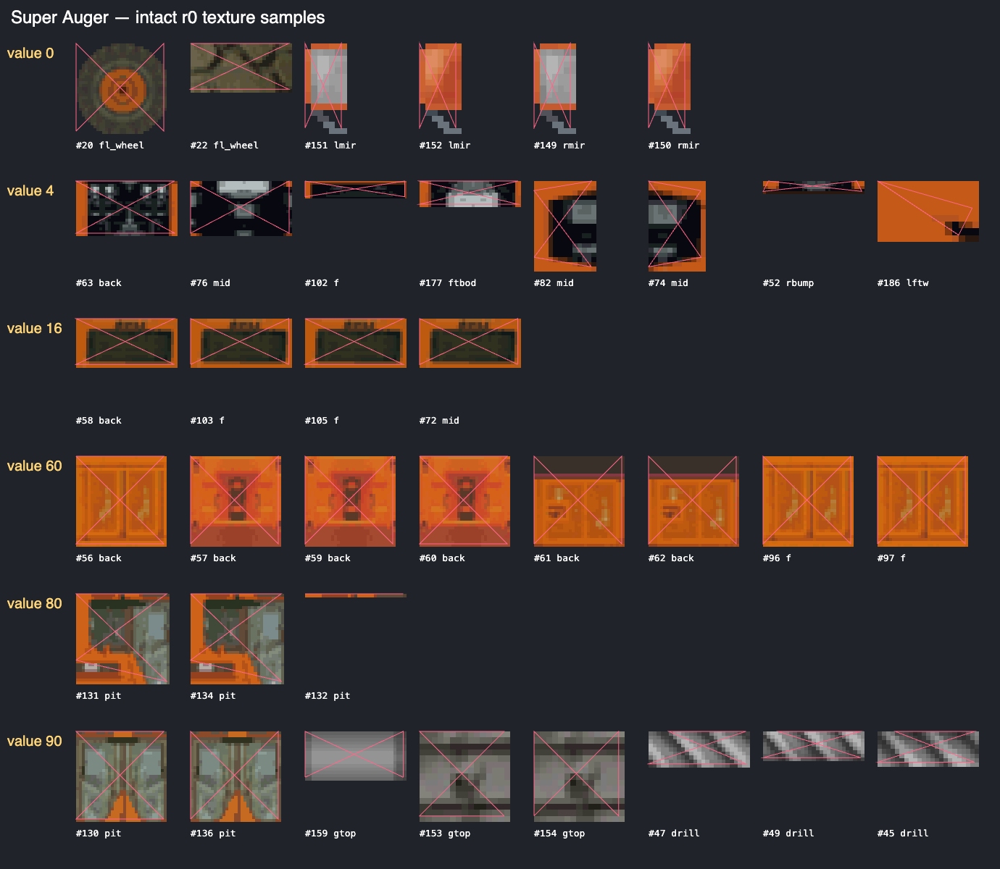
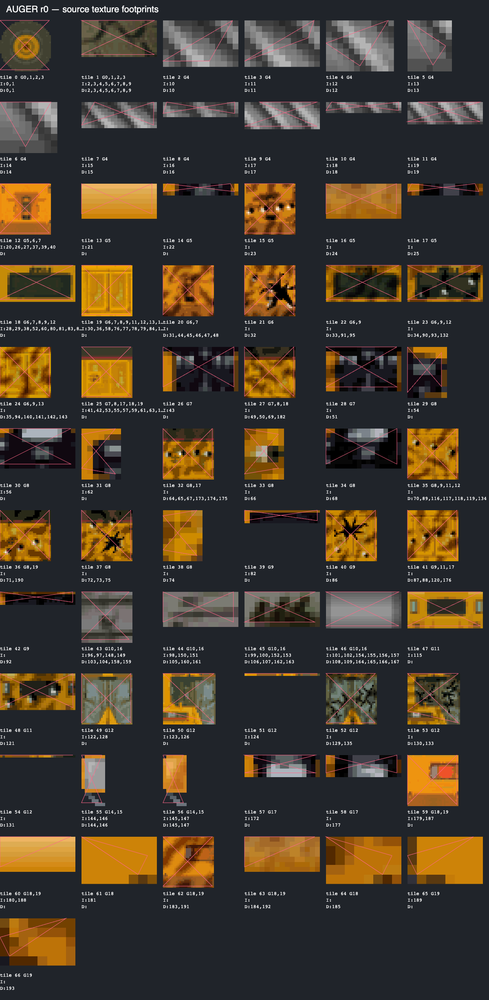
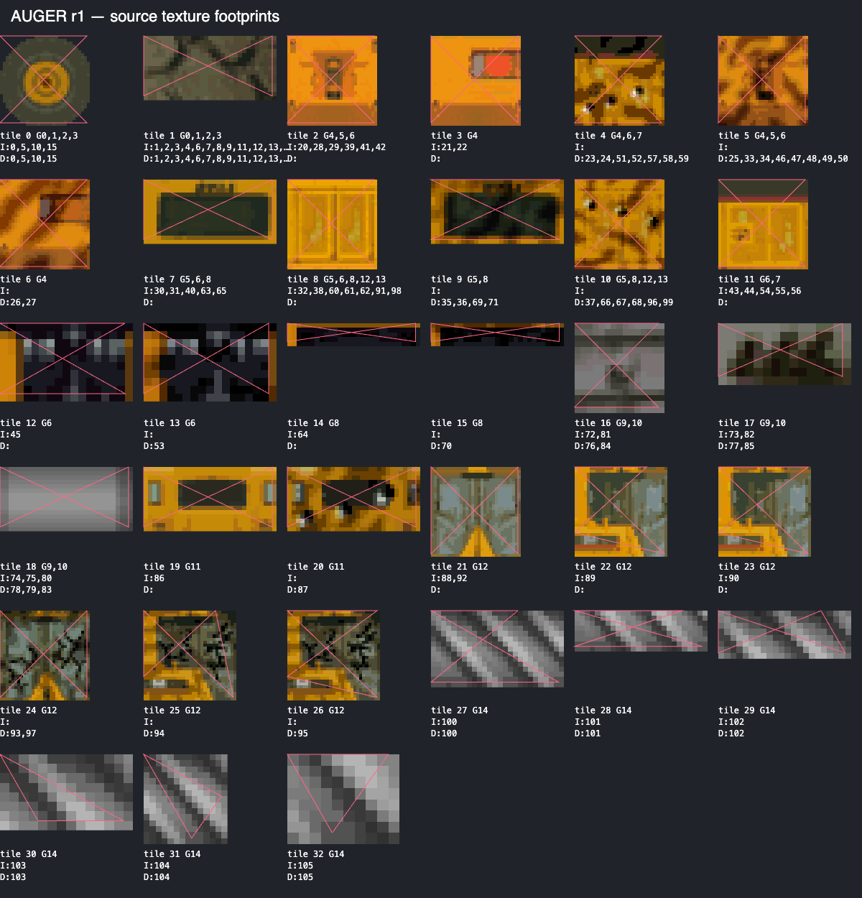
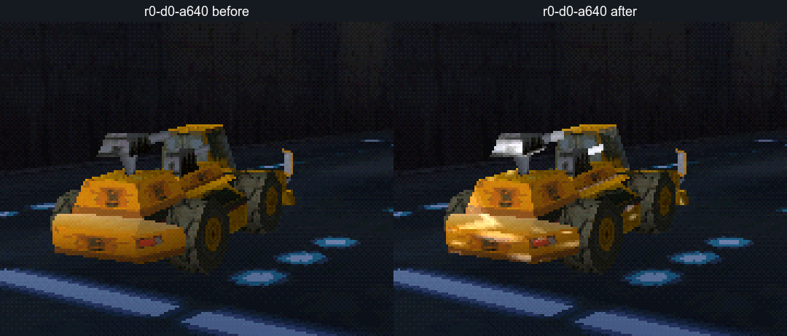
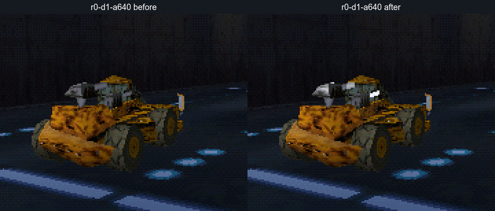

# Auger surface reflections

Auger keeps the industrial hierarchy of TM4 Super Auger: bright painted panels,
a stronger metallic drill and tools, subdued recesses, matte tyres and mirrors.
These are authored TM3 settings, not recovered TM3 material fields.

## Evidence and decisions

Inspected USA v1.1 `AUGER.CAR`: 194/106/5 source face records in r0/r1/r2,
both damage frames, group positions and decoded texture footprints.
Indices below refer to source CAR faces, before MR conversion.
The source hash is pinned by the builder catalog.

Super Auger is the closest reference: its wheel, drill, cockpit and body texture
motifs are visibly shared with TM3 Auger, with different paint coloration. Exact
UV matches alone are insufficient: some damaged UV footprints match both wheel
and body faces with different strengths. Decisions use the part and frame as well.

| Surface | Value | Original TM4 reference and decision |
| --- | --- | --- |
| Intact yellow panels and fenders | 60 | `AUGER.MR` back #56–57 and front #96–97 use 60. Preserve its industrial painted finish rather than Sweet Tooth's softer 30. |
| Black recessed horizontal panels | 16 | TM4 back #58, middle #72 and front #103/#105 use 16 on the matching dark panel motif. |
| Dark underbody, bumper stripe and fender end planes | 4 | TM4 rear bumper #52, middle #74/#76/#82 and wing #186 use 4. Keep these accents subordinate to paint. |
| Drill | 90 | TM4 drill #45/#47/#49 use 90. TM3 G4 is shared by intact/damaged r0, G14 by r1. Its callback rotates the group and lighting matrix, then returns to the ordinary car renderer; unlike Sweet Tooth's detached head, it retains that renderer's reflection layer. |
| Gun and upper metal housing | 90 | TM4 gtop #153/#154/#159 and mgun use 90. TM3 retains their metal textures in damaged geometry; retain the finish there too. |
| Near cockpit glass/metal composite | 80 or 90 | TM4 pit #130/#136 use 90; angled #131/#134 and thin #132 use 80. TM3 r0 #122/#128 get 90, #123/#124/#126 get 80. Do not assign 90 to the dark inset #125: it stays 16. |
| Medium cockpit | 90, painted top 60 | TM4 r1 cockpit has five faces at 90 and one at 60. TM3 has four corresponding glass/metal faces and one paint face; author its indices independently. |
| Damaged paint and cockpit | 8 | TM4 damaged back/front/middle/pit use 8. The TM3 cracked and burned replacement textures receive the same subdued treatment. |
| Wheels, including yellow hub texture | 0 | TM4 Super Auger keeps wheel faces #20/#22 matte. A yellow hub shares the wheel face with rubber. |
| Mirror faces and their yellow backs | 0 | TM4 lmir #151/#152 and rmir #149/#150 are explicitly matte despite their grey appearance. Preserve this exception. |
| Distant r2 | 0 | All original TM4 r2 faces are matte; TM3's five-face distant mesh follows this rule. |

## Source boundaries

The figures show texture crops, not simulated reflections. `I`/`D` mark intact
and damaged source face indices; `G` identifies the source geometry group.
Shared records are listed in both states. A whole face receives one strength;
these settings do not imply texture masks or newly split geometry.

r0 G0–3 are wheels, G4 the rotating drill, G10/G16 metal housings, G12 the
cockpit, and G14–15 mirrors. The remaining groups form the body, suspension,
bumpers and fenders. Damaged body records get 8; shared drill records stay 90.

r1 G0–3 are wheels, G9–10 metal housings, G12 cockpit and G14 the shared drill.
The source r1 rear bumper has three intact and five damaged faces. No fixed
index offset or automatic copy from r0 is used.

## Verification

Implemented and inspected in Neon City using engine RGB readback: three near
angles, intact/damaged r0 and r1, and matte r2. Only reflection bytes differ from
baseline conversion; every built-MR group/frame/LOD matches the source-face map.
The existing Auger attack check also passed drill contact, damage and release,
including 154 ticks compared after local rollback and portable restoration.
Reflection-byte hashes also returned to their original values after cloak/shield
input sequences, a directly injected freeze timer, local rollback and portable
restore. This isolates material lifetime; it does not test freeze-projectile aim.

