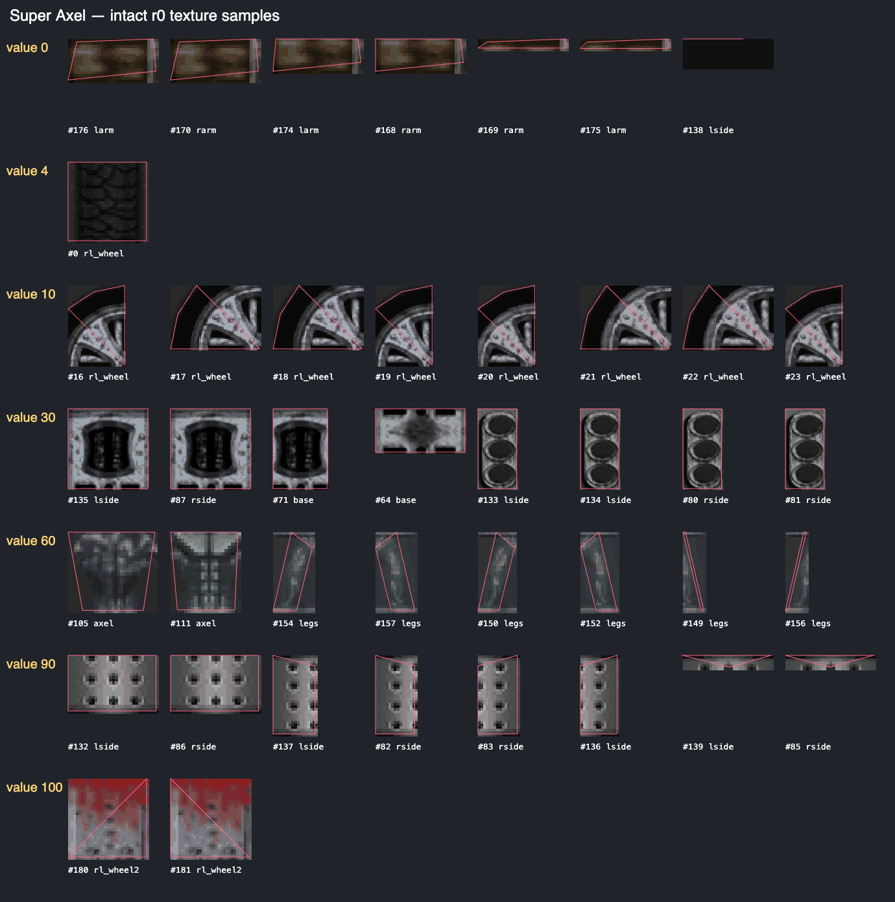
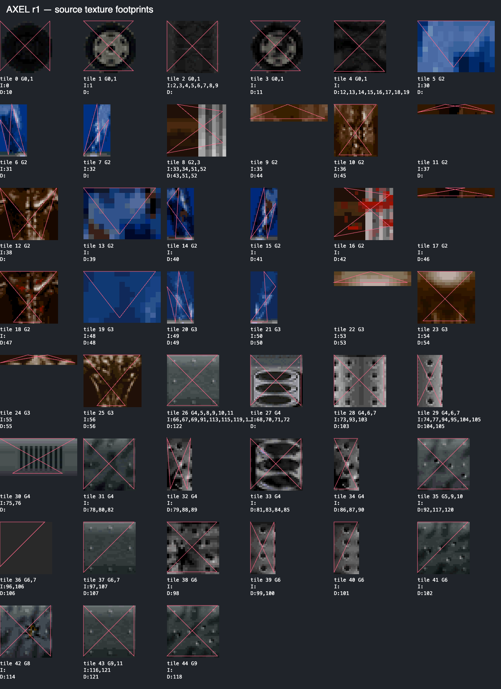
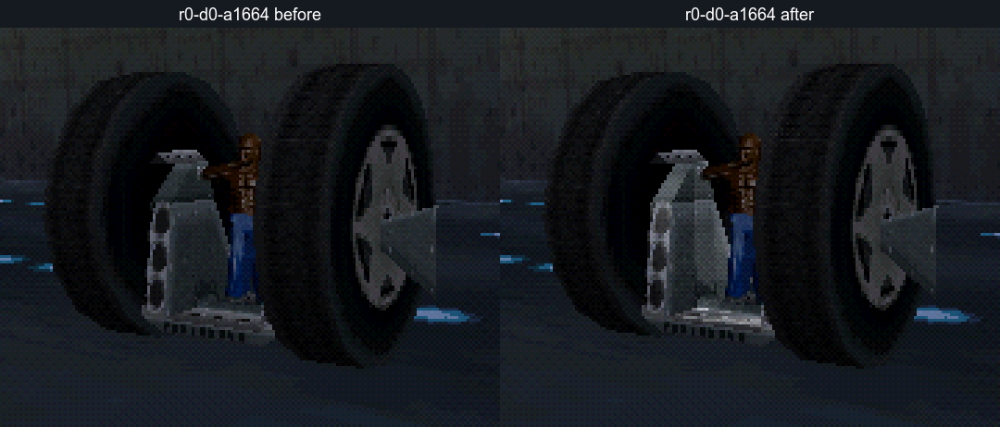
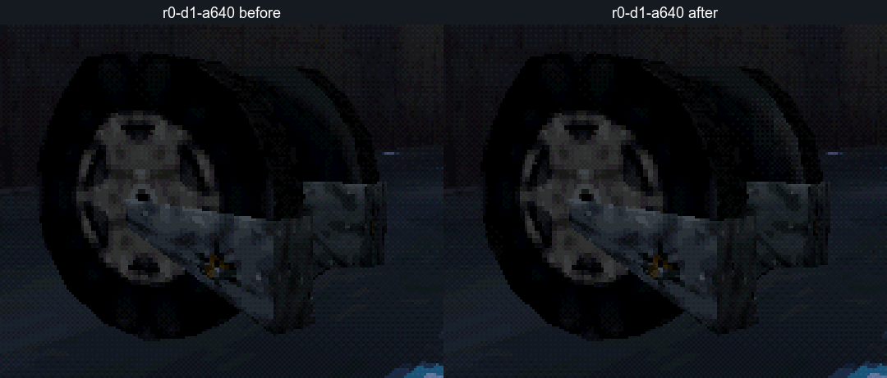

# Axel surface reflections

Axel separates rubber, a restrained mechanical frame, brighter exposed plates,
and a matte human figure. The closest reference is TM4 Super Axel, but its armored
central figure is not a material reference for TM3's skin and clothing.
These are authored settings, not recovered TM3 reflection data.

## Evidence and decisions

Inspected USA v1.1 AXEL.CAR, both frames and all LODs: 296/125/5 source records.
Not every record is referenced; wheel groups share face ranges. Assignments use
source indices before conversion, with the input hash pinned by the car catalog.

| Surface | Strength | TM4 reference and adaptation |
| --- | --- | --- |
| Tyre tread | 4 | Original AXEL.MR near tread #0 and medium wheel treads use 4. Retain a barely visible highlight on the large curved surface, including its damaged replacement. |
| Wheel sides and hub | 10 | Super Axel near sides #16–23 use 10. TM3 mixes rubber and hub in the same triangles; keep this low strength instead of treating the entire wheel as polished metal. The inner dark faces stay at the same low 10 to preserve the original wheel hierarchy. |
| Blue-grey frame and recessed/grille panels | 30 | Super Axel base #64/#71 and side #135 use 30. TM3 frame paint, crossmembers and vent faces get a moderate finish; the grille shares a face with its surrounding frame. |
| Bright perforated plates and narrow braces | 90 | Super Axel side plates #132/#86 and narrow strips #82/#137 use 90. Apply to the corresponding TM3 perforated plate/brace motifs, not all grey pixels. |
| Solid dark end planes | 0 | Super Axel lside #138 is matte. TM3 r0 #159/#169 and r1 #96/#106 are dark caps rather than reflective plates. |
| Damaged frame and plates | 10 | Super Axel damaged base and side plates mostly fall to 10 (some side faces use 5). TM3's broken/scorched frame gets 10, without an arbitrary global multiplier. |
| Shared intact geometry in damaged state | Keep authored strength | TM3 r0 G9 and r1 G7 reuse their intact left plate records, unlike the right replacement. Their unchanged plate remains bright. Other shared intact frame faces likewise retain their finish; no runtime damage override is introduced. |
| Skin, hair, clothing, boots and mixed skin/restraint faces | 0 | TM4's exposed arms are matte, while its central armor uses 60. TM3 has a human figure, not that armor: applying 60 would make blue trousers and bare skin look metallic. Even the narrow pale restraints share texture footprints with skin; leave them matte. |
| r2 | 0 | All original TM4 distant car meshes are matte. |

## Geometry boundaries

Near G0–1 are wheels, G2–10 the frame and side plates, G11 the main figure and
G12 its animated arms. Near source records #64–95 and #171–175 are not used by
these frame ranges and receive no authored values.
Medium G0–1 are wheels, G2–3 the figure, G4–11 the mechanical structure.
Its wheel sides collapse to one face each, while the tread remains eight faces;
a source-index offset from r0 would assign the wrong materials.

Bright metal is reserved for the plates and braces. TM4's additional wheel2
faces at 100 have no matching auxiliary group in TM3 and are not copied onto the
ordinary tyre or human figure. This is a material adaptation, not a claim that
the two models have identical topology.

## Verification

Implemented after recording the material decisions. Inspected engine RGB frames
in Neon City at three near angles and in both damage states for all three LODs.
The frame picks up a highlight without making the human figure or tyres metallic.
Damaged replacement plates are subdued; r2 retains its matte appearance.
The built MR matches every source-face assignment in every group and frame, and
only reflection bytes differ from baseline conversion.

The existing Axel shockwave test passed damage, local rollback and portable
snapshot replay. A separate material-lifetime check compared reflection-byte
hashes before and after real cloak/shield input sequences, local rollback and
portable restore. Freeze was injected through its ordinary 90-tick timer to
isolate material restoration: the Outlaw-oriented firing fixture missed Axel,
so this check does not claim to verify freeze-projectile targeting.

