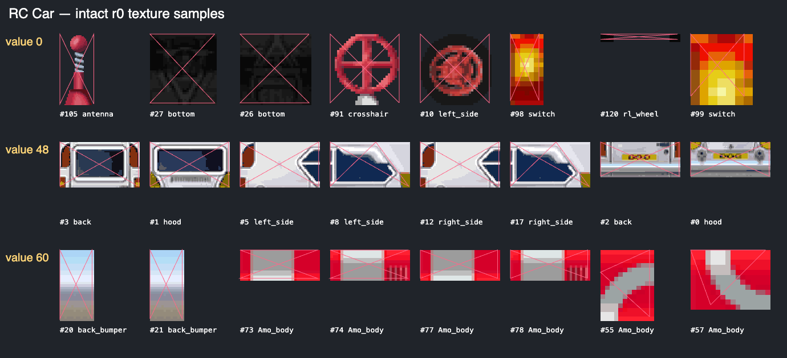
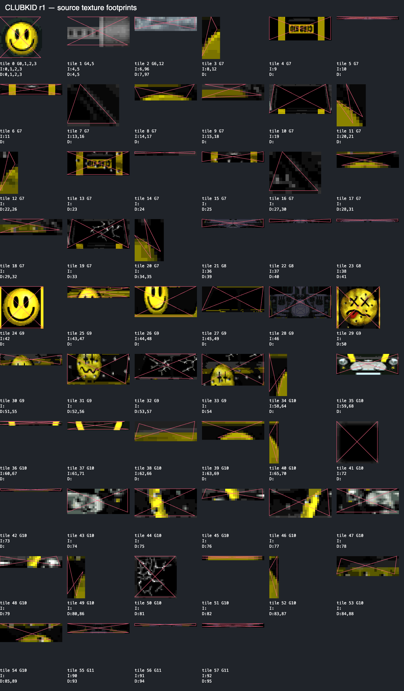
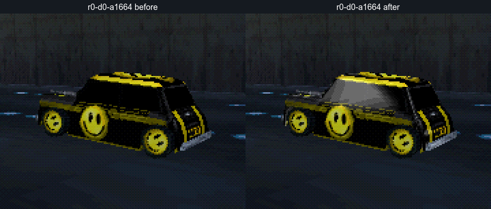
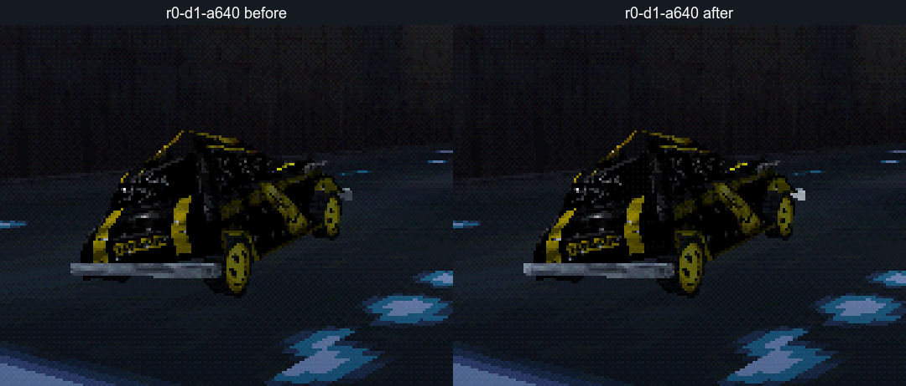

# Club Kid surface reflections

Club Kid gets a glossy black/yellow body with readable smile graphics, brighter
metal bumpers, distinct glass and matte tyres. The smile on a wheel stays matte
even though the smile on the body receives the painted-body finish.
These are authored additions, not recovered TM3 fields.

## Evidence and decisions

Inspected USA v1.1 CLUBKID.CAR: 259/98/5 source face records, both damage frames,
all texture footprints and group positions. Checked its unmodified geometry in
Neon City before choosing the material palette. Source identity is pinned by the
builder catalog; indices below refer to CAR records before group splitting.

RC Car is the closest TM4 finish reference for a compact graphic-covered vehicle:
its patterned body uses 48, bumpers 60 and tyres 0. Moon Buggy's metallic 60/80
would make Club Kid's rounded painted shell too uniformly bright. Pizza Boy's 17
is a useful subdued alternative, but not the selected glossy finish.

| Surface | Strength | Evidence and reasoning |
| --- | --- | --- |
| Black/yellow shell and printed smile panels | 48 | RCCAR.MR hood #0/#1, side #4–9 and roof #28–29 use 48. Black painted pillars receive the same finish as yellow panels; color alone does not define a cavity. |
| Windshield, rear glass and side windows | 64 | WAGON.MR window #35 uses 64. TM3 near windshield #115, rear #54/#59 and sides #105/#111 are separate enough to use a stronger glass finish. The thin yellow window surround shares the face and also receives 64; no extra polygon subdivision. |
| Metal bumpers | 60 | RC Car bumper #20–25 uses 60. TM3 front/rear bumper groups use the same clean metal texture in both states; bent damaged geometry retains that finish. |
| Guns | 48 | RC Car l_gun uses 48. TM3's two gun groups share intact records with damaged state; their finish stays constant. |
| Lower yellow crossmembers | 16 | Super Auger's recessed frame uses 16. Subdue the lower structure relative to the shell instead of making it as shiny as the bumpers. |
| Tyres and wheel smiles | 0 | RC Car tyres are matte. The wheel smile spans a face with rubber and follows that surface, not the body decal. |
| Underbody and solid dark closure faces | 0 | RC Car bottom #26/#27 and dark inserts use 0. TM3 G5 #100 is the horizontal underside, not a window despite its detailed grey texture. Near #61/#154 close dark recesses. |
| Broken/scorched shell and shattered windows | 4 | Moon Buggy replacement body and Pizza Boy damaged body commonly use 4. The cracked window should not flash as strongly as intact glass. Guns, bumpers and wheels use their separately reviewed unchanged materials. |
| r2 | 0 | Matte, as in every original TM4 distant car mesh. |

## Boundaries and LOD

Near G0–1 are the guns, G2–3 bumpers, G4 rear shell, G5 cabin, G6 front shell,
G7–8 lower crossmembers, G9–10 underside, and G11–14 wheels. Geometry positions
identify #32/#33/#52/#53 as rear upper pillars, so their nearly black texture
still receives paint strength. Front lamp textures include surrounding paint;
they stay at body strength rather than giving the whole face a glass boost.

Medium G0–3 are wheel cards, G4–5 guns, G6/G12 bumpers, G7 rear shell, G9 cabin,
G10 front shell and G8/G11 the lower pieces. The windshield moves from near G5 #115 to medium G10 #72, alongside the front
shell rather than the cabin group; its geometry still identifies it as glass.
It keeps 64, as do r1 rear window #19 and side windows #45/#49. Medium lower pieces combine yellow
paint and dark underbody and receive the subdued 16.

## Verification

Implemented after documenting the decisions. Built-MR validation confirms only
reflection bytes changed, with every source assignment preserved through group
splitting, damage frames and LODs. Inspected three near camera angles and both
frames of r0/r1/r2 in Neon City through engine RGB readback. Glass produces a
clearer highlight than paint, smile graphics remain readable, wheels stay matte,
and shattered replacement surfaces are subdued.

The Club Kid special check passed, including local rollback and portable snapshot
replay. Reflection-byte hashes also return to the authored values after real
cloak/shield input sequences and an injected 90-tick freeze timer, including
local rollback and portable restoration. The latter check isolates material
lifetime rather than projectile targeting.

