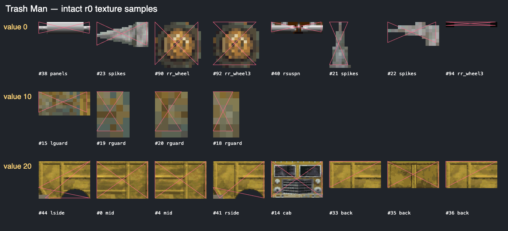
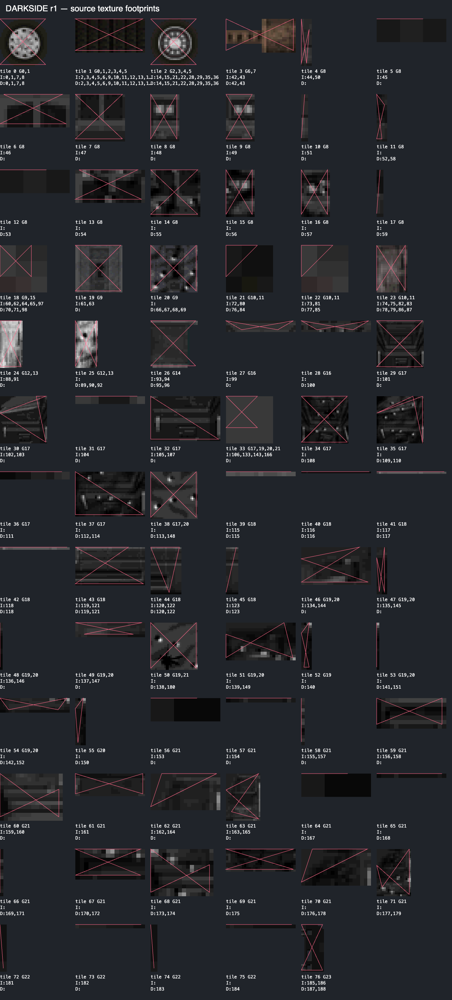
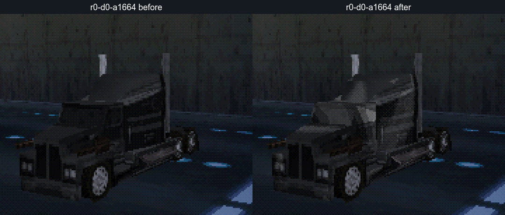
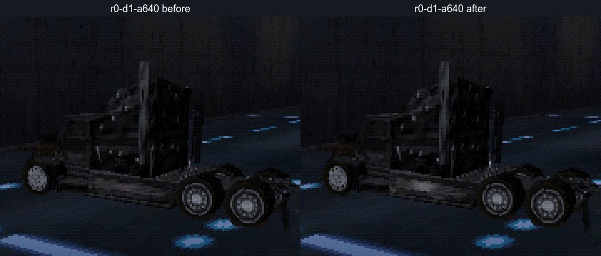

# Darkside surface reflections

Darkside keeps a subdued black industrial finish. Windows and vertical exhausts
provide the strongest accents; its large aerodynamic fairing is painted metal,
not a giant mirror. These are authored TM3 settings informed by TM4 resources.

## Evidence and decisions

Inspected USA v1.1 DARKSIDE.CAR: 235/189/10 source records across r0/r1/r2,
both frames, decoded texture regions and vertex positions. Viewed the matte
truck in Neon City before assigning materials. Source identity is pinned by the
builder catalog; indices below precede MR conversion and group splitting.

Trash Man is the closest reference for the dark heavy vehicle: its cab #8–14
and rear body #29–37 use 20; damaged replacements largely use 2. Calypso's 16
and Crusher's 16 support a restrained industrial baseline, rather than Club Kid's
48 or Super Auger's 60 painted finish.

| Surface | Strength | TM4 precedent and choice |
| --- | --- | --- |
| Black cab panels, hood and upper fairing | 20 | Trash Man cab/body 20. Keep the large dark surfaces readable without washing out their panel textures. |
| Actual cab windows | 64 | Joneses window #35 uses 64. Near #194/#218 are the upper side windows and #221 the windshield. These belong to the lower cab, not the large upper fairing. |
| Vertical exhaust stacks | 60 | Drag Queen's exposed pipe details use 60. TM3 stacks have an explicitly bright silver texture, retained on bent replacement geometry; retain 60 in both frames. |
| Horizontal tanks and front grille/bumper assembly | 30 | Super Axel's exposed base/frame #64/#71 uses 30. Tarnished tanks and mixed grille/metal faces are less polished than the vertical stacks. Dark tank end caps stay 0. |
| Guns | 30 | Gen. Warthog gun faces use 30 and keep it in the damaged frame. TM3's bronze-toned shared gun faces also retain a moderate finish. |
| Rear chassis, running boards and front fenders | 10 | Trash Man guard #15–20 uses 10. These lower working surfaces stay subordinate to the cab and bright exhausts. |
| Damaged replacement body, glass and front assembly | 2 | Trash Man's damaged cab, body and guards use 2. Crumpled black panels and broken glazing should no longer flash like clean surfaces. |
| Wheels, rear mudflaps, underbody and dark tank caps | 0 | Trash Man wheels, wells and underside are matte even when a texture contains a bright hub. Rear flaps are not chrome bumpers. |
| Unchanged shared parts in damaged state | Keep material | Near left lower cab G24 is shared rather than replaced. Its original window remains 64, its painted panels 20. Shared running boards, tanks and guns also retain their individual finish. |
| r2 | 0 | All original TM4 distant meshes are matte. |

## Geometry resolves ambiguous textures

Near G15 is the high fairing, while G19/G24 form the lower hood/cab sides.
The plain grey texture on fairing #106/#107 is also used on the hood and fenders;
it is not a glass material ID. Its coordinates rise to y=-217, above the cab.
Actual windshield #221 spans the front lower cab at y=-165 to -131, z=160–175.
Near side windows #194/#218 occupy the same height band. Thus the fairing gets
20 and the lower glazing gets 64 despite very different texture brightness.

Near G6–7 are horizontal tanks, G10–11 vertical exhausts, G12 rear flaps,
G16 running boards, G17–18 fenders, and G22–23 guns. Wheel groups reuse records;
unused near records #151–162 and #226–234 are not assigned.

Medium G17 combines the fairing into seven faces; G21 combines both sides of the
lower cab. Its windshield #161 and side windows #162/#164 get 64 independently
of near indexing. Both damaged side windows are replacement faces in this LOD,
whereas near G24 stays shared. Do not force the two damage topologies to agree.

## Verification

Implemented after documenting the decisions. Built-MR validation confirms only
reflection bytes changed and all source assignments survive group splitting,
both frames and all LODs. Inspected engine RGB readback in Neon City at three
near angles and both frames for r0/r1/r2. The fairing stays subdued; lower cab
windows and tanks provide visible highlights without whitening the truck.

The existing flames check passed Darkside's attack, target freeze, damage and
175 compared ticks after rollback/portable restoration. A separate material
check returned the original reflection-byte hashes after cloak/shield input
sequences and an injected freeze timer, with local rollback and portable restore.
The timer injection isolates material lifetime; the flames check separately
exercises the real attack hit. No video was recorded.

