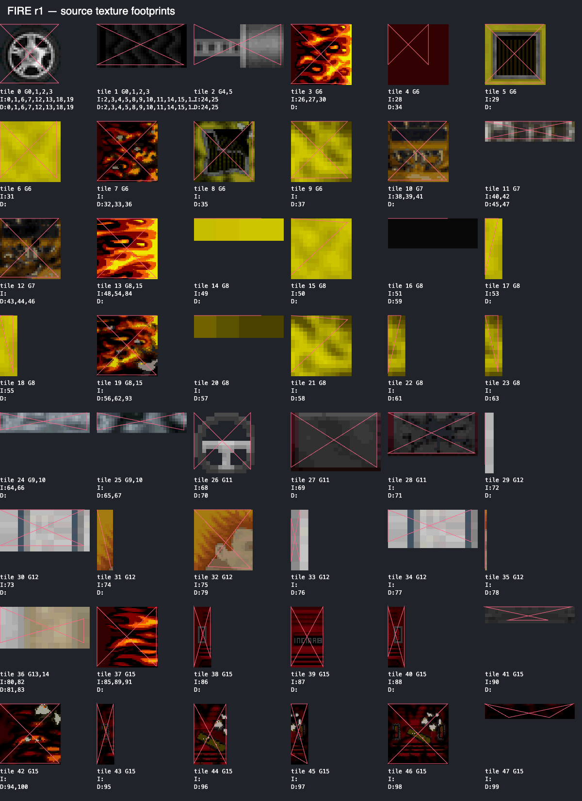
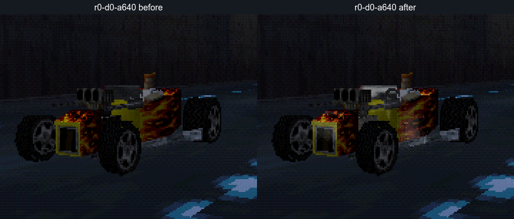
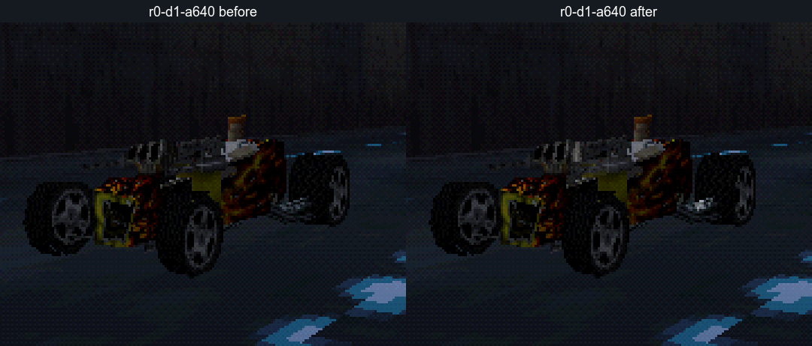

# Firestarter surface reflections

Firestarter is an open hot rod: flame-painted panels, an exposed engine and bright
side exhausts. Its driver remains matte. These are authored additions, not recovered
TM3 material fields.

## Evidence and decisions

Inspected USA v1.1 FIRE.CAR: 212/102/5 source records across r0/r1/r2, both frames,
texture footprints, group positions and the unmodified car rendered in Neon City.
The builder pins the source hash. Indices refer to the CAR before conversion.

Drag Queen is the closest TM4 material reference: side panels #24–27/#68–71 and
rear body #122–130 use 30; exhaust faces #84–87 use 60; wheels and underside use 0.
Its bumper strength 220 is deliberately not copied: Firestarter has narrow pipes
and suspension links rather than a broad polished chrome bumper.

| Surface | Strength | Reason and TM4 precedent |
| --- | --- | --- |
| Flame-painted body and yellow cowl | 30 | Drag Queen's painted panels. Preserve the flame artwork while adding moving highlights. |
| Front grille with its painted surround | 30 | One face contains both grille and paint; treat it as a mixed panel, without making the dark grille a chrome plate. |
| Silver side exhausts, engine braces and front links | 60 | Drag Queen pipes #84–87. Bent exhaust replacements retain their silver texture and finish. |
| Dark engine block and guns | 30 | Super Axel exposed frame 30 and Gen. Warthog guns 30. Keep these less bright than the silver pipes. |
| Windshield | 64 | Joneses window #35. Only near #202 and medium #69 are the actual slanted glass pane. |
| Damaged painted panels, grille and windshield | 2 | Trash Man's damaged panels use 2. Keep scratches and broken glass subordinate to the remaining metal. |
| Damaged dark engine covers | 2 | Their replacement texture is scarred; unchanged block faces and silver braces keep their own material. |
| Driver, steering wheel, seat, tyres, wheel-side composites, underside and internal closing faces | 0 | Human skin and clothing are not metal. Drag Queen also keeps complete wheel-side faces matte despite bright rims. |
| Distant r2 | 0 | Matches all original TM4 distant meshes. |

## Geometry resolves ambiguous textures

Near G15 is the driver's white shirt, G16 his head, and G17/G18 his arms. G16
uses transform slot 4: the existing Firestarter callback rotates it with steering.
Its orange/cream texture is hair and skin, not an amber metal ornament. All of
these faces stay 0. Medium G12 combines the shirt and head; G13/G14 are arms,
and remain matte in both frames.

Near G23 contains both the small steering wheel (#200/#203) and the separate
wide windshield (#202/#205). The former is centred in front of the driver at
z=1–5; the latter spans the cowl at z=17–23. The wheel is 0, intact glass 64 and
broken glass 2. Medium G11 has the same distinction (#68/#70 versus #69/#71).

G6 is the exposed engine: dark block #46–52, silver braces #53–59/#61 and dark
intake #60. Damage shares several texture regions but substitutes the scarred
covers #66–68; it does not imply making every engine surface equally dull.
G4/G5 side exhausts keep 60 in both frames. Yellow undersides and dark closing
faces are excluded even when they share a colour with an exterior panel.

## Verification

Implemented after recording the material decisions. Built-MR comparison confirms
that only 163 reflection bytes changed; source-face assignments survive all LODs,
damage frames and converted group splitting. Engine RGB stills in Neon City cover
three near angles, both frames and r0/r1/r2. The driver remains matte, while the
windshield, painted panels and silver exhausts catch distinct highlights.

The original flamer check passes attack damage, effect cleanup and 175 compared
ticks through local rollback and portable restoration. A separate material check
restores the original reflection-byte hashes after real cloak/shield input
sequences and an injected freeze timer, including both restoration paths. Timer
injection checks material lifetime, not freeze-projectile targeting. Lint, type
checks and formatting pass. No video was recorded.

