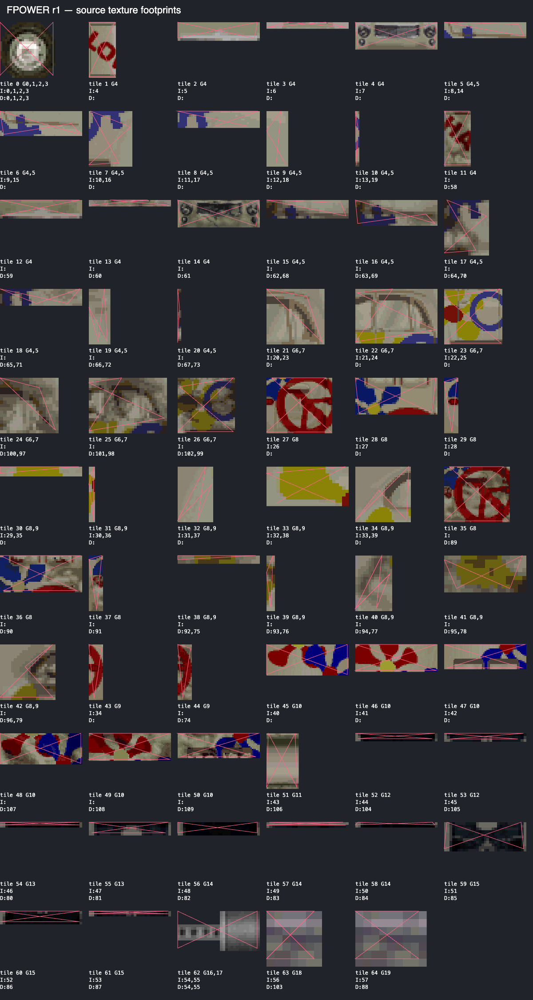
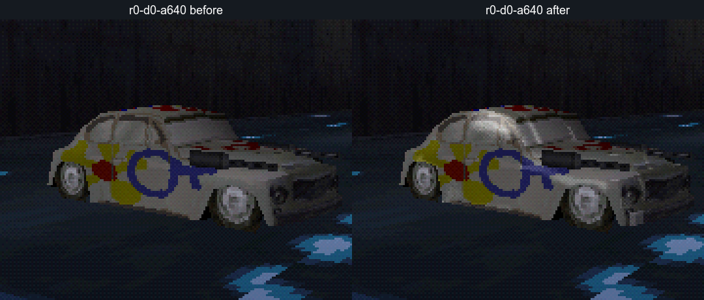
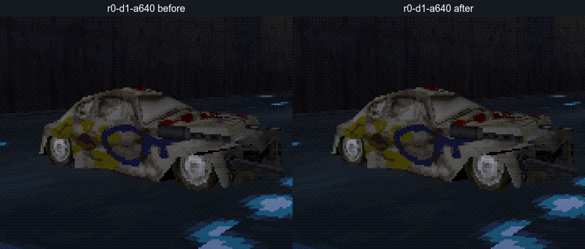

# Flower Power surface reflections

Flower Power keeps its light, flower-painted body rather than becoming a chrome
car. The Joneses is the closest TM4 reference: a civilian car with restrained
paint, clearly separated windows and bright bumpers.

## Evidence and decisions

Inspected USA v1.1 FPOWER.CAR: 246/110/5 source records, both damage frames,
texture footprints and group geometry. Viewed the matte car in Neon City from
three angles before assigning a profile. The builder pins the input hash.

Original Joneses near resources use 24 on hood #39/#40, side #5–10 and roof #37;
64 on front bumper #32–34 and windows #35/#36/#38; 4 on gun surfaces; 0 on
wheels. Its replacement damaged body, glass and bumper become 0, while the guns
retain their weak metallic finish. This coherent palette suits Flower Power's
cream paint and graphic flowers better than RC Car's 48 or Auger's 60 paint.

| Surface | Strength | Decision |
| --- | --- | --- |
| Cream and flower-painted panels, roof, rear slope and fenders | 24 | Joneses paint. Reflect gently without bleaching the pale background or decorative flowers. |
| Side windows and separate windshield | 64 | Joneses glazing. Dark window surrounds belong to the same faces and share the value. |
| Front and rear bumper strips | 64 | Joneses front bumper. These have a distinct grey metal texture, unlike the cream body. |
| Front lights/grille faces with body surrounds | 24 | Mixed face: preserve the body material rather than lighting the whole rectangular patch as chrome. |
| Guns, both damage states | 4 | Joneses guns. They are secondary accessories on this car, not the main bright accents. |
| Replacement damaged paint, glass and bumpers | 0 | Joneses damage treatment. The replacement texture and dents provide detail without clean reflections. |
| Tyres, complete wheel-side faces, underbody and distant r2 | 0 | Original Joneses wheels and original TM4 distant models are matte. A bright hub in a shared tyre face is not a separate material. |

## Mapping boundaries

Near G7/G8 contain three window faces each (#59–61/#66–68), then two painted
door panels and their lower lips. Coordinates separate glass at y=-99..-60 from
the lower painted doors. G13 #108/#109 is the separate windshield. G12 is the
roof and decorated rear slope; its rear #104/#107 remains paint, not inferred
glass from position alone. The right rear slope carries the flower artwork,
and the texture does not isolate a separate rear window.

The front metal strip G4 and rear G11 are independent of the front lamp/grille
patches in G5/G6. G14–G17 form the underside and stay matte. Damage substitutes
near #133–241; only the replacement gun records #242–245 retain 4.

Medium windows are #20/#21/#23/#24 and windshield #43. The simplified front face
#7 combines grille, lights and cream surrounds and keeps 24. Bumpers #56/#57 use
64; guns #54/#55 are shared by both frames. Damage-only #58–109 stays 0.

## Verification

Built-MR validation confirms that only 144 reflection bytes changed, with exact
source-to-MR assignments across all LODs and both frames. Engine RGB stills in
Neon City cover three near angles and both frames for r0/r1/r2. The flower
artwork remains legible; clean windows and bumpers catch stronger highlights,
while damaged panels retain their original matte appearance.

The material-lifetime check passed real cloak/shield input sequences and an
injected freeze timer, local rollback and portable restoration, returning the
original reflection-byte hashes. The timer probe does not test freeze aiming.
Lint, type checks and formatting pass.

The existing Flower attack test passes launch, direct damage and local/portable
replay, then fails its destroyable-world-target phase with "No pending world hit".
A control run of the same current module with all reflection bytes zeroed fails
at exactly the same assertion. World-hit coverage is therefore still unverified;
this is not reported as a passing full attack test. No behavior code was changed
or assertion weakened for the material work.

