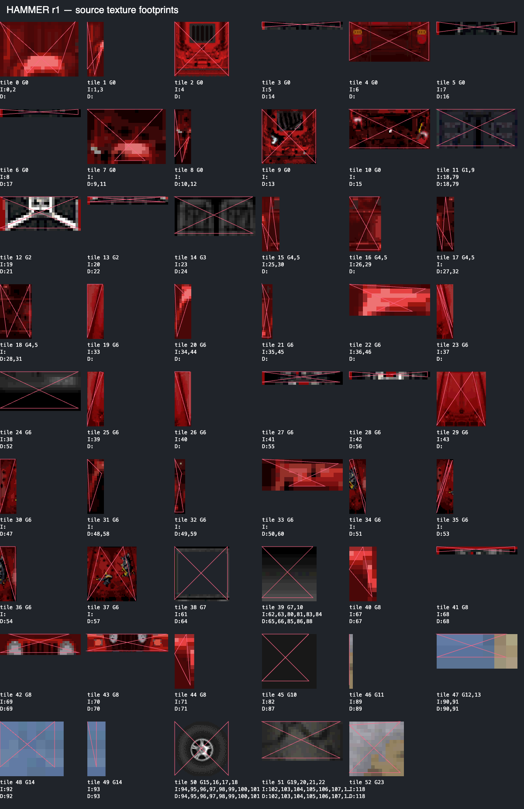
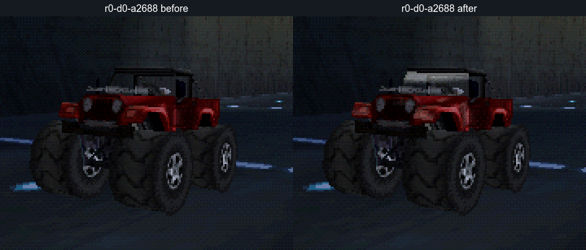
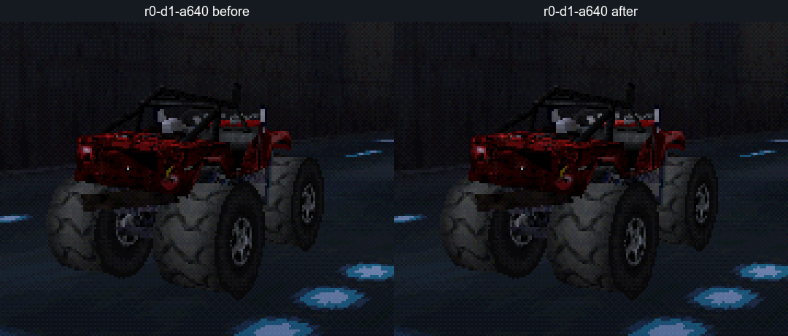

# Hammerhead surface reflections

Hammerhead keeps a red working-truck finish with matte giant tyres. The open
cab's dark roll cage must not be mistaken for a glossy roof or side windows.

## Evidence and decisions

Inspected USA v1.1 HAMMER.CAR: 227/119/5 source records, both frames, texture
footprints, vertex coordinates and an engine-rendered matte preview in Neon City.
The builder pins source identity. Assignments use original CAR face indices.

Super Slamm is the closest TM4 construction-vehicle reference: its red body is
30, bright cab surfaces 60, dark pipes 5 and wheels 0. Damaged painted surfaces
mostly become 8, bright cab surfaces 16 and replacement pipe pieces 2. Those
relationships suit Hammerhead better than highly polished passenger-car chrome.

| Surface | Strength | Decision |
| --- | --- | --- |
| Red hood, fenders, side panels, rear body and mixed grille/lamp faces | 30 | Super Slamm back #86–91/#93–95 and painted cab surfaces. Keep a red finish without whitening it. |
| Windshield | 60 | Super Slamm bright cab material; this is the single pane, not the surrounding cage. |
| Dark roll cage, windshield frame and dark bumpers | 5 | Super Slamm pipe #72–78. A weak response separates tubing without making it bright chrome. |
| Guns | 30 | Super Slamm gun bodies #40–44/#54–58, retained when the vehicle is damaged. |
| Replacement red panels | 8 | Super Slamm's damaged body treatment. |
| Damaged windshield / bent cage and bumper pieces | 16 / 2 | Super Slamm damaged bright cab / pipe materials. |
| Driver, clothing, mirrors, wheels, underbody and chassis planes | 0 | Keep non-metal surfaces matte. The textured cross-brace plane contains dark gaps; copying Slamm's 90 on separate metal supports would also illuminate those gaps. |
| Distant r2 | 0 | Original TM4 distant meshes remain matte. |

## Geometry and shared parts

Near G4 is the driver's white shirt; G9–G11 are blue clothing, not pale metal
panels. G3 is the steering wheel. All stay 0. G15/G16 are sloped cage supports,
G22 has narrow roof rails with an empty centre. They receive 5, while the separate
windshield #167 gets 60. Its damaged counterpart #173 gets 16.

Near G13 hood/fenders #91–106 is shared between intact and damaged frames, so
its remaining paint keeps 30. Inner firewall #96 and underside #99/#100 stay 0.
Unused near #107–122 are not assigned. G12 front and G14 rear have actual damage
replacements. Chassis G18/G19 and axles G5/G6 remain matte rather than giving a
whole texture rectangle a metallic sheen.

Medium G6 has its own damaged hood; use 8 on those replacement faces even though
near G13 is shared. Conversely, medium G8 front is shared and retains 30. Medium
G10 merges cage supports and roof rails; it remains 5, not glass. Medium #61 is
the windshield, #64 its damaged version. Unused medium #72–78 remain unassigned.

## Verification

Built-MR validation confirms only 219 reflection bytes changed, with exact
source assignments across all LODs, frames and group splits. Inspected engine RGB
stills in Neon City at three near angles and both frames for r0/r1/r2. The red
body catches highlights while the open cage and giant tyres remain subdued.

The existing Hammerhead check passed ram contact/expiry, lethal rear contact,
local rollback and portable restoration, including a marked contact target.
The separate material check recovered original reflection-byte hashes after
cloak/shield input sequences and an injected freeze timer, through local and
portable restoration. Timer injection tests material lifetime, not aiming.
Lint, type checks and formatting pass. No video was recorded.

