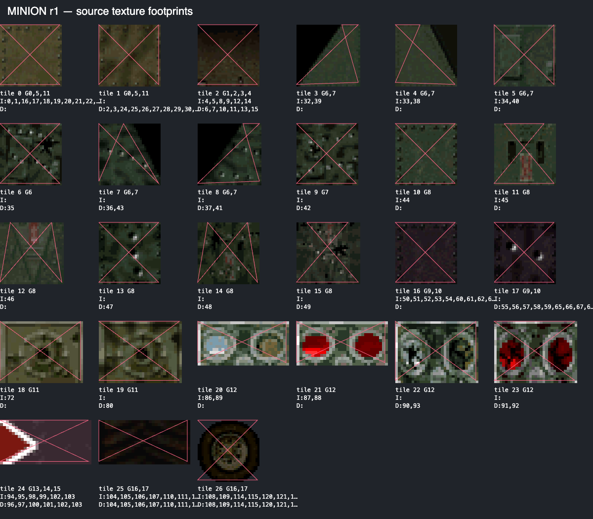
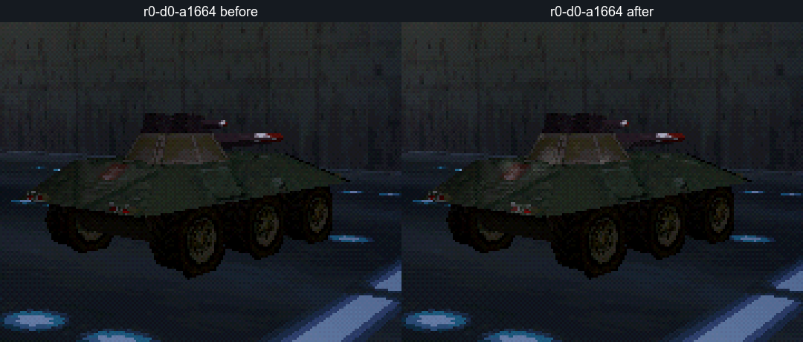
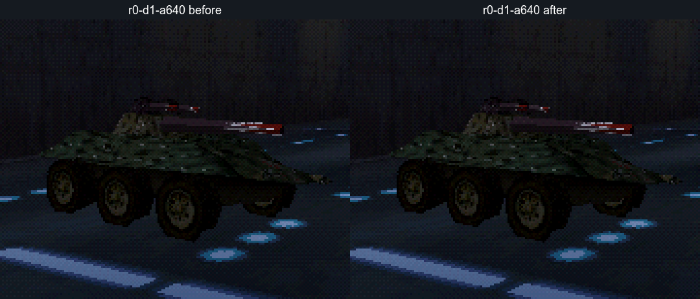

# Minion surface reflections

Minion receives a restrained armoured finish. Camouflage and dark machinery
remain dominant; it has no passenger-car glass or exposed chrome accents.

## Evidence and decisions

Inspected USA v1.1 MINION.CAR: 260/140/5 source records, both frames, decoded
texture footprints, group geometry and a matte engine preview in Neon City.
The six-wheeled TM3 vehicle is not the same model as the tracked TM4 Minion.

An important counterexample: **all intact TM4 Minion faces use 0**. Its damaged
body mostly uses 2, with treads remaining 0. Thus a reflective TM3 Minion is an
authored addition, not a recovered Minion setting. Calypso's body 16 and Crusher's
body 16 establish a restrained industrial reference; Warthog's gun 30 separates
working weapon metal from the hull without chrome strengths.

| Surface | Strength | Decision |
| --- | --- | --- |
| Green upper armour, brown turret and integrated light housings | 16 | Calypso/Crusher industrial body. A light or trim drawn within an armoured face does not turn the whole patch into glass. |
| Dirty lower exterior skirt | 4 | Super Axel tyre tread 4 and Slamm weak working surfaces show how small the response can be. Keep this subordinate to the armour. |
| Dark upper weapon receiver blocks | 30 | Warthog guns. These are separate metal shapes, not rubber or camouflage panels. |
| Red/white painted barrel sides, including bent replacements | 16 | Treat markings as paint on metal, with the hull's modest finish. The replacement retains the same marking texture. |
| Replacement damaged armour and lower skirt | 2 | The original TM4 Minion's damaged-body value, preserving the rough surface. |
| Damaged receiver blocks | 8 | Super Slamm damaged metal/paint uses 8. Exposed machinery keeps a little more response than battered armour. |
| Muzzle end caps, tyres, wheel sides and bottom floor | 0 | No reflective holes or bright rubber. Keep the dark recesses dark even when the opposite coplanar cap uses barrel artwork. |
| r2 | 0 | All original TM4 distant meshes are matte. |

## Mapping boundaries

Near G6 is the bottom floor, not upper armour. G7–G12 form the lower exterior
skirt; G13–G17 and G19 form the upper armour, lamp mounts and turret. Bright
front #88/#92 and red rear #160/#164 are integrated textured housings and retain
16 rather than receiving a separate glass finish.

G18 is the long central barrel. #182/#183 are opposite faces of the same front
cap, so both remain 0. Only its side walls #184–187 get 16; damaged #188/#189
stay 0 and #190–193 remain 16. The upper weapons G20/G21 likewise distinguish
painted barrel sides, dark receiver blocks and paired muzzle caps. No cap is
classified by texture colour alone.

Medium barrels become crossed side planes (#94/#95, #98/#99 and shared
#102/#103), so there are no equivalent cap faces to assign. Receiver blocks
G9/G10 remain 30 (damaged 8). Medium G5 is the lower outer shelf at y=-79 and
gets 4; G0 is the actual floor and remains 0. This is mapped from geometry, not
by copying near indices into the simplified model.

## Verification

Built-MR validation confirms only 304 reflection bytes changed, with exact
assignments across all LODs, frames and group splits. Engine RGB stills in Neon
City cover three near angles and intact/damaged r0/r1/r2. The upper armour has
a subdued moving highlight; wheels and muzzle caps remain matte. Medium receiver
blocks catch stronger highlights without turning the camouflage into chrome.

The Minion check passed its four-projectile volley, damage/freeze/thaw, rear-wheel
pivots, local replay and portable restoration into a fresh match. A separate
material check recovered original reflection-byte hashes after cloak/shield input
sequences and an injected freeze timer, through local and portable restoration.
Timer injection tests material lifetime, not aiming. Lint, types and formatting pass.

