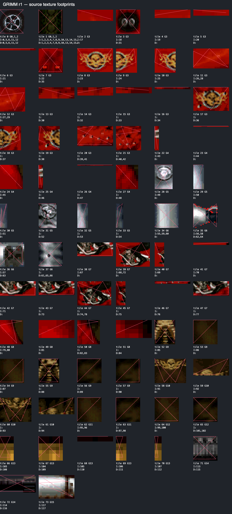
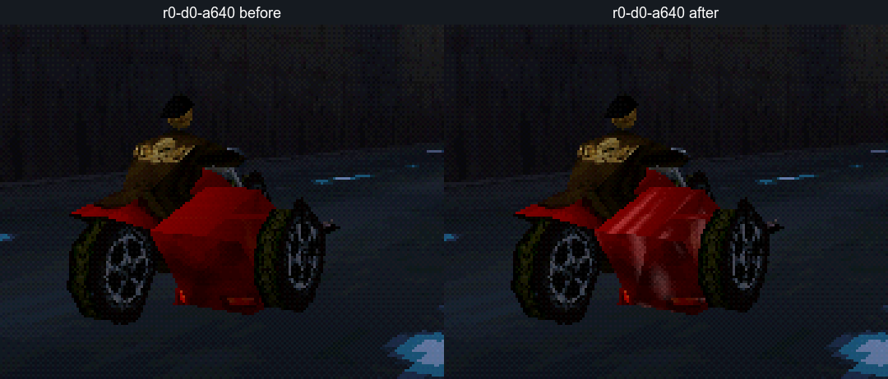
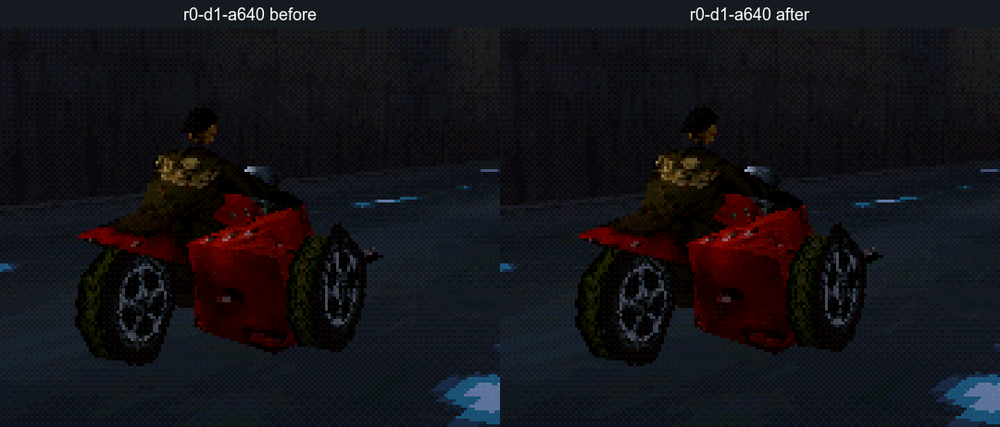

# Mr. Grimm surface reflections

Mr. Grimm separates red lacquer and bright motorcycle hardware from the matte
rider, saddle and tyres. Capt. Grimm's TM4 name is not a material reference by
itself: the appropriate references are exposed machinery and painted vehicles.

## Evidence and decisions

Inspected USA v1.1 GRIMM.CAR: 314/119/5 source records, both damage frames,
texture regions, group coordinates and the matte motorcycle with sidecar in
Neon City. Input identity is pinned by the builder catalog.

| Surface | Strength | TM4 precedent and choice |
| --- | --- | --- |
| Red tank, frame panels and skull-painted sidecar | 30 | Drag Queen's red painted body uses 30. The skull is printed artwork on the sidecar, so it shares the surrounding paint rather than becoming gold metal. |
| Exposed engine faces mixed with red frame | 30 | Super Axel frame #64/#71 uses 30; keep the dense mechanical texture readable rather than treating every silver pixel as a separate polished material. |
| Silver fork, headlamp housing and exhaust | 60 | Drag Queen exposed pipes #84–87 use 60. The headlamp lens and rim share faces; use the same moderate bright assembly finish. |
| Sidecar gun, excluding near end cap | 30 | Gen. Warthog gun finish. Its separate replacement geometry retains the material, like unchanged gun surfaces in TM4 damage states. |
| Damaged red panels and mixed engine faces | 4 | Crusher's damaged painted surfaces use 4. Keep a weak response without intact lacquer highlights. |
| Damaged fork/headlamp assembly | 16 | Quatro's bright hardware drops from 80 to 16 on damaged replacements. TM3's broken lens and tarnished fork use this dull metal treatment. |
| Exhaust, intact and bent | 60 | Its replacement retains a silver metal texture; unlike the fork it has no broken glass or strongly tarnished finish. |
| Rider's head, clothing, saddle, wheel composites, underside and dark recesses | 0 | Human/cloth surfaces are not polished metal. Original TM4 wheels such as Drag Queen's are matte even where the texture includes a bright rim. |
| r2 | 0 | Original TM4 distant meshes have no surface reflections. |

## Group boundaries and LOD differences

Near G7 is the animated head (slot 4), G6/G14–G18 the upper body and arms, and
G12 combines legs with rear fender pieces. Head and clothing remain 0 in both
frames. G12's explicitly red #239/#245 receive 30, their damaged counterparts
#250/#256 receive 4; the mixed saddle/rear-cover #246/#257 stay matte.
Medium G8 merges the saddle/side-fender region: mixed #79/#80 remain 0, while
the separate red rear-cover #81 is 30 (damaged #84 is 4). This avoids adding
highlights to a seat merely to preserve a nearby painted fragment's finish.

The skull emblem on near G9 #170–174 belongs to the sidecar body. It is distinct
from the actual head G7. Sidecar floor #177–179/#192 and the dark recessed panel
#185 are 0; corresponding damaged floor/recess records remain 0 as well. Medium
G3 keeps floor #20/#21 and recess #18 matte, independently of surrounding red
faces. Near engine dark cutouts #53/#57 remain 0.

G1/G2 contain the headlamp and silver fork, with inner #28/#36 kept dark; G5 is the exhaust, with the inner
cap #92/#95 left matte. G8 is the sidecar gun, whose near triangular cap
#164/#169 stays dark. Medium G15 shares its exhaust face across damage states.

## Verification

Built-MR validation confirms that only 196 reflection bytes changed, with exact
assignments across all LODs, frames and converted group splits. Inspected engine
RGB stills in Neon City at three near angles and both frames for r0/r1/r2.
Highlights follow the red sidecar, tank and metal, without polishing the rider.
Damaged lacquer and fork are visibly subdued.

The existing Grimm check passed launch, direct damage, world-object collision,
head steering, local rollback and portable restoration. The separate material
check passed cloak/shield input sequences and an injected freeze timer through
both restoration paths, recovering the original reflection-byte hashes. The
injected timer checks material lifetime, not freeze-projectile targeting. Lint,
type checks and formatting pass. No video was recorded.

