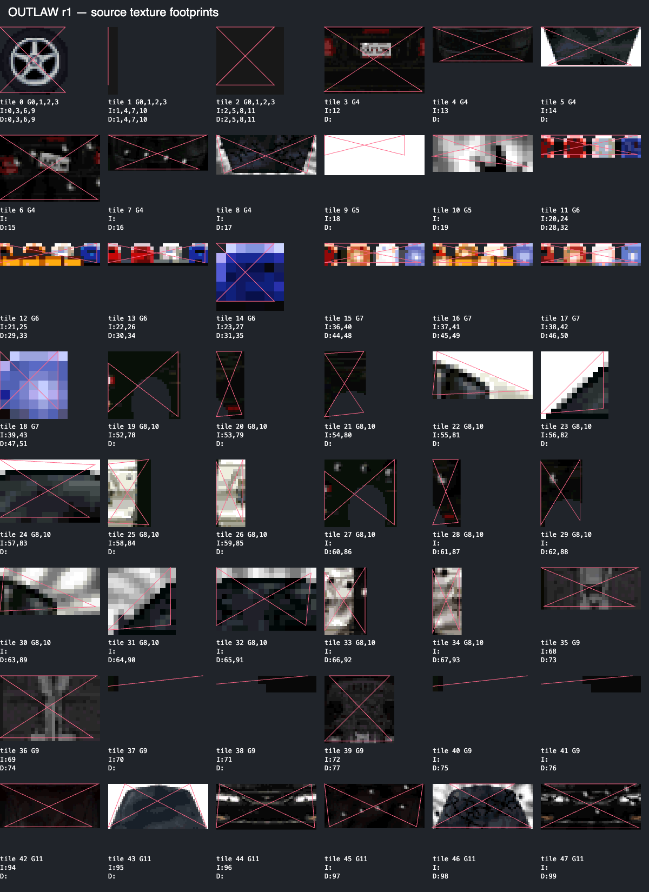
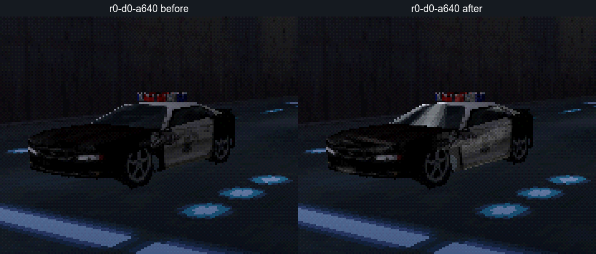
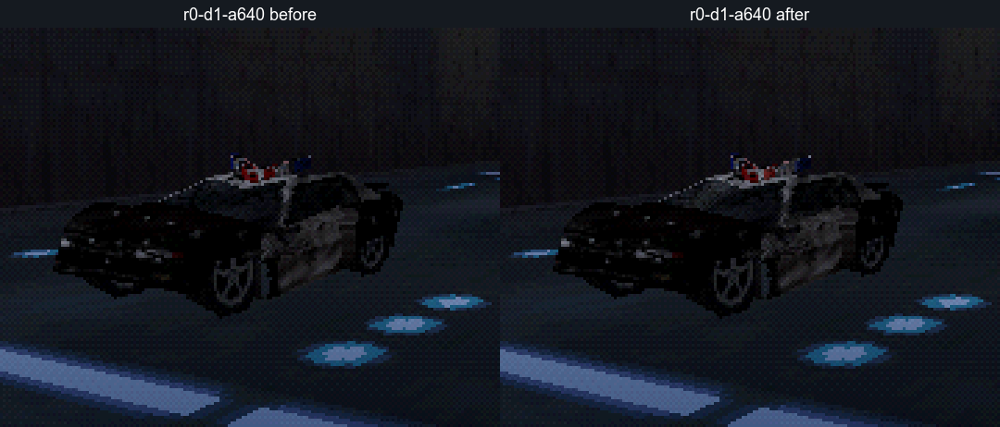

# Outlaw surface reflections

Outlaw keeps its black-and-white patrol-car finish. Paint, glazing, guns and the
coloured light bar have separate responses; bright pixels alone do not mean chrome.

## Evidence and decisions

Inspected USA v1.1 OUTLAW.CAR: 266/100/5 source face records, both frames,
texture footprints and group geometry, plus a matte engine preview in Neon City.
There is no Outlaw model among the original TM4 cars. The closest material
reference is The Joneses: ordinary car paint 24, glass 64, wheels 0. Meter Maid
provides a useful restraint: its blue cab/trim uses 25 rather than chrome strengths.
These are authored choices, not recovered TM3 reflection fields.

| Surface | Strength | Decision |
| --- | --- | --- |
| Black/white body, roof, pillars, bumper skins and integrated lamps | 24 | Joneses paint. Both paint colours share one finish; labels and headlamps printed on a body face do not turn that whole face into chrome. |
| Windshield, rear window and large side panes | 64 | Joneses glass. Keep narrow white pillar triangles at paint strength. |
| Side gun bodies and crossed barrel planes | 30 | Warthog guns; moderate weapon-metal finish without a bright chrome accent. |
| Red/blue light-bar surfaces, both animation sets and damage frames | 25 | A restrained coloured-plastic response. Meter Maid's coloured trim 25 is a strength reference, not evidence of an original beacon material. The resource reuses clean light-bar textures in damaged frames. |
| Damaged body | 4 | Super Thumper damaged paint; battered panels lose their polished appearance. |
| Damaged glazing | 16 | Super Slamm's reduction of bright cabin faces to 16. Cracks remain legible. |
| Damaged gun bodies | 8 | Super Slamm damaged working metal/paint. |
| Wheels, wheel wells and bottom floor | 0 | Joneses wheels and common TM4 underside exclusions. Printed wheel spokes are not independently addressable metal faces. |
| r2 | 0 | Original TM4 distant meshes are matte. |

## Mapping boundaries

Near G5 #20/#22 are windshield panes; #21/#23 are predominantly white pillar
triangles and remain 24. G6 #58/#59 are rear glazing, #60/#61 the white roof.
Side windows #128/#168 get 64, while quarter pillars #122/#174 remain 24.
The damaged equivalents are tracked separately rather than inferred by colour.

G8/G9 include the side guns: #116–121 and #162–167. The long barrel records
are crossed planes, not wheel trim. G10/G11 span the wheel wells, and G12 is
the underside; all stay matte. The full-width front/rear textured skins include
lights and plates, so their material stays at the body value.

G13/G14 are coincident alternative light-bar geometry in transform slots 4/5.
Both receive the same 25, including their damage-frame counterparts, so the
reflection does not change simply because the beacon animation selects the other
texture set. Medium G6/G7 preserve those alternatives. Medium #14/#57/#83/#95
are the remaining glazing; #55/#56/#81/#82 are white pillars. The medium mesh
has no separate side-gun geometry to invent or brighten.

## Verification

Built-MR validation confirms only 310 reflection bytes changed, with exact
assignments across all LODs, frames and group splits. Inspected engine RGB stills
in Neon City at three near angles and both frames for r0/r1/r2. Glass takes a
clear highlight while black paint stays black and the red/blue beacon stays coloured.

The Outlaw check passed lightning damage/lift, target changes, emitter lifetime
and three-tick siren alternation, replaying 82 ticks through local rollback and
portable restoration into a fresh match. The material check recovered original
reflection-byte hashes after cloak/shield input sequences and an injected freeze
timer through both restoration paths. Timer injection tests material lifetime,
not aiming. Lint, types and formatting pass.

