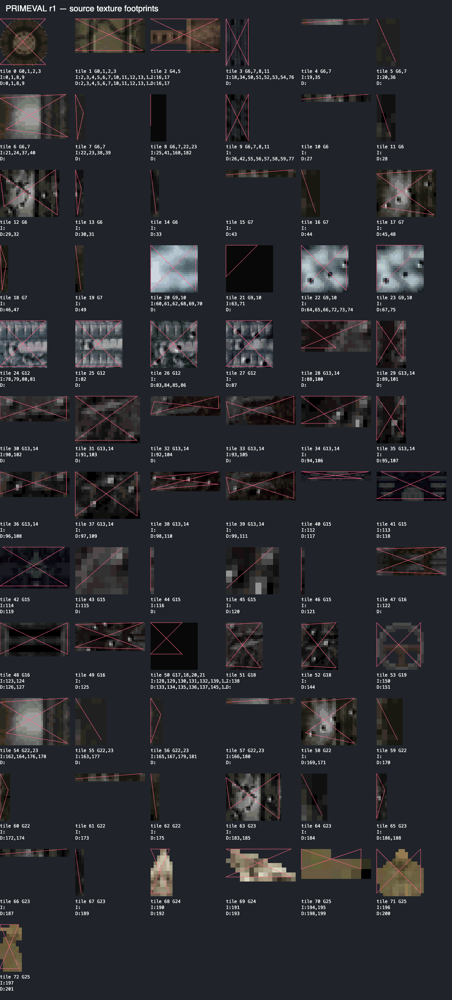
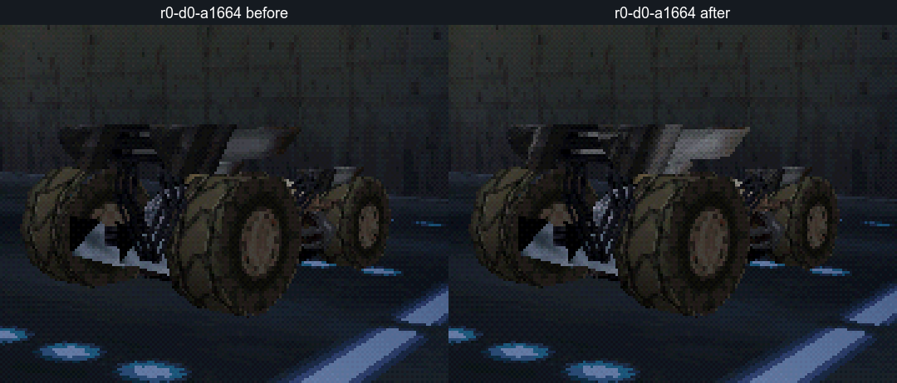
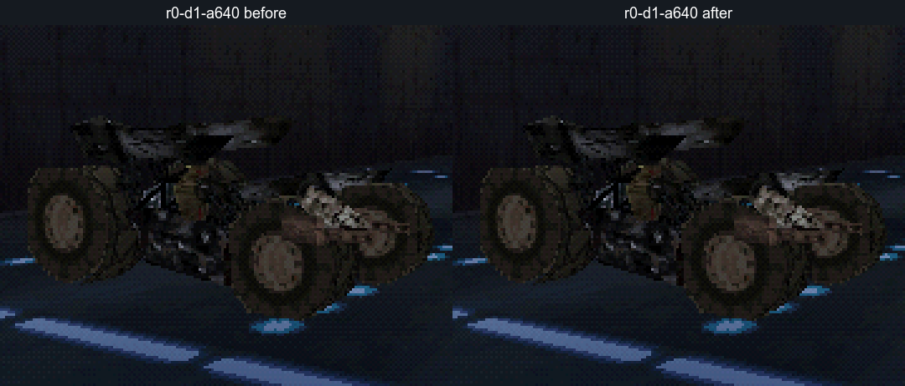

# Primeval surface reflections

Primeval is an exposed machine with a driver and a bone-like front ornament,
not a painted passenger car. Its silver rear housings are the strongest accents;
weapons and structural panels remain darker.

## Evidence and decisions

Inspected USA v1.1 PRIMEVAL.CAR: 458/202/5 source face records, both frames,
texture footprints, vertex positions and a matte engine preview in Neon City.
There is no original TM4 Primeval material to recover. Super Axel is the closest
structural reference, but its bright 90 plates would overpower this model's worn
brown surfaces. Use the lower industrial values seen on Calypso/Crusher instead.

| Surface | Strength | Decision |
| --- | --- | --- |
| Silver-blue rear housings | 60 | Drag Queen metal pipes and Super Slamm bright metal/cab faces. These are closed metal prisms, not windows. |
| Large upper and smaller forward weapon shells, shared forward barrels, engine block | 30 | Warthog gun 30 and Super Axel mechanical frame 30. Keep the prepainted shading and brown wear visible. |
| Dark solid chassis side panels and nose | 16 | Calypso/Crusher industrial body; distinguish panel surfaces from the black open framework. |
| Solid black cage tubes | 5 | Super Slamm dark pipe 5. A small highlight can describe a tube without making the entire cage chrome. |
| Damaged silver housings / weapons and engine / panels / cage | 16 / 8 / 4 / 2 | Super Slamm reduces bright surfaces to 16, painted/working surfaces to 8 and pipes to 2; Calypso/Crusher damaged body uses 4. |
| Driver, bone-like nose ornament, seat, controls, wheels, bottom floor and muzzle caps | 0 | Human/organic surfaces and dark holes are not metal accents. Original TM4 wheels commonly use 0. |
| Flat strut-texture planes | 0 | Their image contains dark gaps. An environment highlight across the whole polygon would visually fill those gaps. |
| r2 | 0 | Original TM4 distant meshes are matte. |

## Mapping boundaries

Near G4/G5 are the long high weapon shells; G6/G7 contain the smaller forward
shells and separate flat support planes. The shells get 30, but muzzle caps
#37/#65/#92/#124 and supports #93/#94/#110/#111 remain 0. G9/G10 crossed
barrel planes are shared across damage frames and retain 30.

The silver housings are G12/G13. Their caps #182/#196 (damaged #189/#203)
stay 0, including the damaged cap whose texture also contains silver artwork.
G15 is the engine. G16/G17 side panels receive 16; G16 deliberately reuses
#226–231 in both frames, so its unused #232–237 are not assigned. The medium
model does have a separate damaged left panel and uses 4 there.

G18 contains three bottom-floor faces that remain 0 and two rear panel faces
#253/#254 that receive 16. G19 nose is panel metal. G20 seat stays 0. G23's
engine deck #280 receives 30; its black cage tubes #281–294 receive 5. G26/G27
continue the solid cage. G24 controls and the entire G25 driver remain 0, as does
G8's bone-like ornament, including the damaged versions.

The dark strut texture is used on the rear frame G11, axle G14, suspension
G21/G22 and parts of G6/G7/G24. These remain matte rather than inheriting a whole
group's metal value. Medium G8/G11 and support #18/#34 follow the same rule.
Medium G24 is the simplified bone ornament and G25 the driver; neither inherits
near group numbers or a bright metal classification.

## Verification

Built-MR validation confirms only 364 reflection bytes changed, with exact
assignments across all LODs, frames and group splits. Inspected engine RGB stills
in Neon City at three near angles and both frames for r0/r1/r2. Weapons and
silver housings catch highlights; the driver, bone ornament, wheels and dark
strut gaps remain matte. Lint, types and formatting pass.

The material check recovered original reflection-byte hashes after cloak/shield
input sequences and an injected freeze timer, through local rollback and portable
restoration into a fresh match. Timer injection tests material lifetime, not aiming.

The existing Primeval special-attack check stops at its initial projectile-speed
comparison ("Original speeds changed"). A control run with every reflection byte
zeroed fails at the same assertion. Thus this is not evidence of a reflection
regression, but the special-attack test's later collision/replay coverage remains
unverified in this run. The assertion was not weakened and behavior code was not changed.

