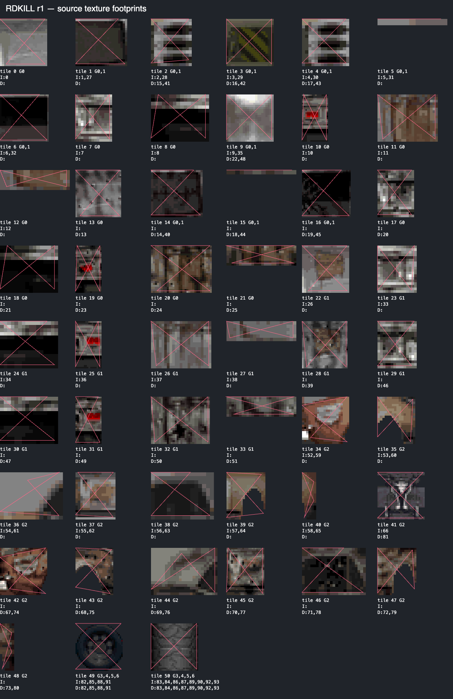
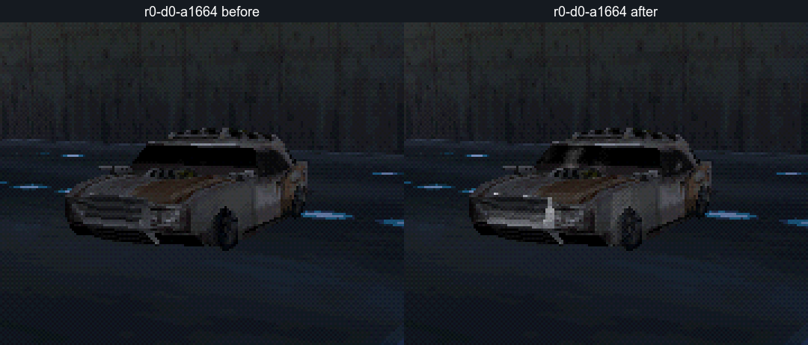
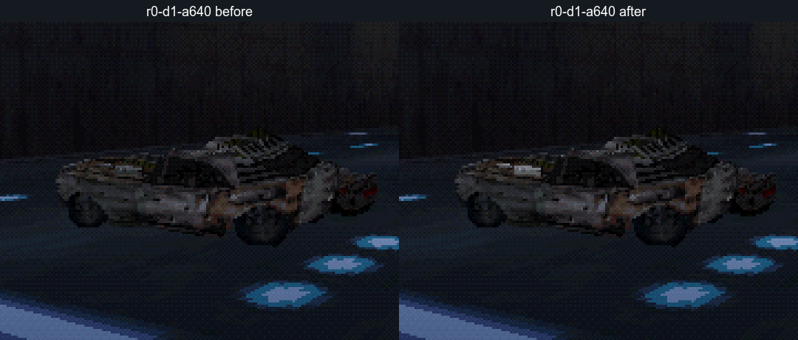

# Roadkill surface reflections

Roadkill keeps its patched, worn finish. This is restrained industrial metal,
with brighter glazing and a small clean-metal accent on the separate front guard.

## Evidence and decisions

Inspected USA v1.1 RDKILL.CAR: 206/94/5 source face records, both frames,
texture footprints, geometry and an engine preview in Neon City. Several panels
mix rust, grey paint and patches on a single face. Splitting those by colour would
invent material boundaries absent from the geometry.

| Surface | Strength | TM4 reference and reasoning |
| --- | --- | --- |
| Patched body, roof, bonnet and hazard-marked intake shells | 16 | Super Thumper paint and Calypso/Crusher industrial panels. Keep rust visible and avoid polishing the whole salvage car. |
| Main window panes | 40 | Meter Maid cab glass uses 40; a less glossy finish than Joneses 64 suits the worn car. |
| Shared side guns | 30 | Warthog guns. End caps stay 0; the same geometry survives in damaged frames. |
| Separate front guard's grey side plates | 60 | Super Slamm/Drag Queen bright metal. Only #185–189, not the whole front grille or bonnet. |
| Dark guard strip and bonnet intake top | 30 | Working metal rather than chrome; grilles with dark gaps remain 0. |
| Damaged body / windows / guard | 4 / 8 / 8 | Super Thumper damaged paint 4 and Meter Maid/Slamm reduction of brighter surfaces to 8. |
| Wheels and crossed spike planes, underside, slatted vents, gun end caps | 0 | Rubber and holes remain matte. The wheel spikes are textured crossed rectangles, not triangular solid metal geometry; reflecting the whole rectangles would expose their background. |
| r2 | 0 | Original TM4 distant meshes are matte. |

## Mapping boundaries

Near window panes are #82/#84/#85/#87/#109/#135; white pillars and the roof
remain at body strength. The roof has separate hazard-marked vent shells G14/G15,
while #160/#161/#173/#175 are slatted openings. Their side walls stay 16 but the
openings stay 0. Side vents #111/#137 also remain 0. This distinction survives in
medium #2/#4/#28/#30; medium #54/#61 merge the upper side/pillar region and use
16 rather than guessing separate glass or vent pixels.

G4/G5 side gun walls #24/#25/#28/#29/#31/#32/#35/#36 retain 30 in both frames;
the end caps remain 0. G6 is the shared bottom floor, and unused #50–61 are not
assigned. G16 is the front guard: #183 has 30, #184 is a matte grille, #185–189
have 60; damaged side plates #192–196 use 8. G17 bonnet intake separates
hazard side walls #197/#198 (16), grille #199 (0), and top #200 (30).

The medium mesh omits separate gun and guard geometry. Its merged front body
faces stay 16; no artificial chrome rectangle replaces the missing guard. Medium
windows are #1/#6/#27/#32/#56/#63, with their damaged counterparts at 8. Wheel
spikes disappear in this LOD; the remaining wheel faces stay 0.

## Verification

Built-MR validation confirms only 215 reflection bytes changed, with exact
assignments across all LODs, frames and group splits. Inspected engine RGB stills
in Neon City at three near angles and both frames for r0/r1/r2: the rust remains
subdued, windows reflect, and the separate guard catches a small bright accent.
Lint, types and formatting pass.

The material check recovered original reflection-byte hashes after cloak/shield
input sequences and an injected freeze timer, through local rollback and portable
restoration into a fresh match. Timer injection tests material lifetime, not aiming.

The Roadkill special check passed launch, in-flight snapshots, world-impact area
burst and both replay paths, then failed its separate direct-contact damage
assertion (target health stayed 6144). A control with all reflection bytes zeroed
fails identically. Direct-contact coverage therefore remains unverified here;
this is not evidence of a reflection regression. The assertion and behavior code
were left unchanged.

