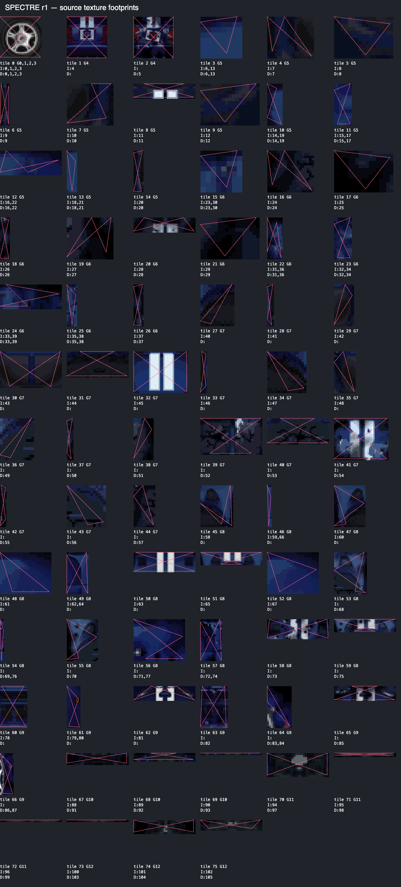
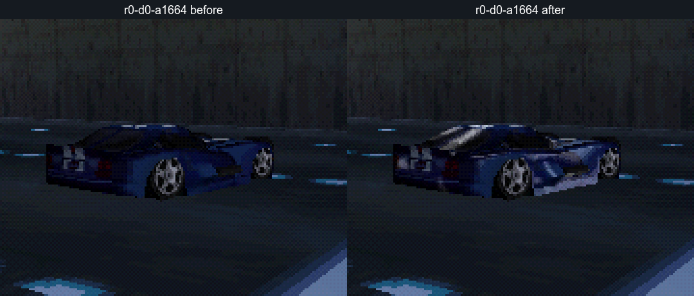
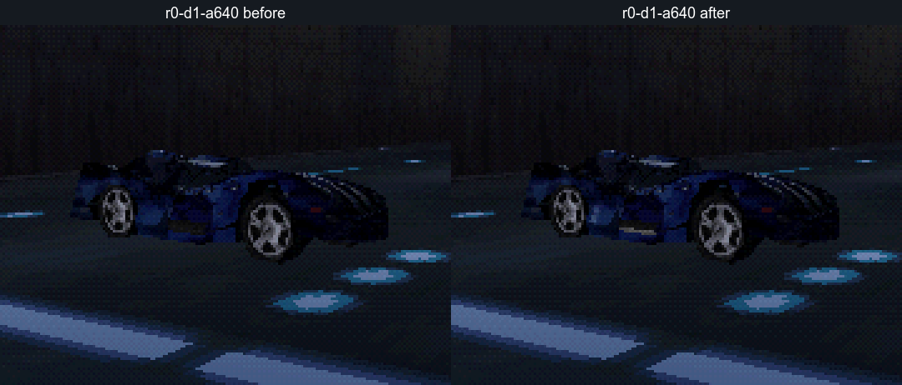

# Spectre surface reflections

Spectre uses a glossy blue-and-white sports-car finish, separate dark glazing
and bright side pipes. These are authored choices, not recovered TM3 values.

## Evidence and decisions

Inspected USA v1.1 SPECTRE.CAR: 287/106/5 source face records, both frames,
texture footprints and vertex positions. The stripes belong to paint; dark
windows are separate from the striped roof and blue pillars.

| Surface | Strength | TM4 reference and reasoning |
| --- | --- | --- |
| Blue body, white stripes and painted side housings | 48 | RC Car painted panels: a cleaner, glossier finish than Roadkill's worn 16. Uniform paint strength avoids treating white racing stripes as metal. |
| Window panes | 80 | Super Thumper glass. Glazing should catch more light than the paint without using a chrome material. |
| Separate side pipes | 60 | Drag Queen and Sweet Tooth bright metal. Only the narrow grey pipe walls, not their blue housings. |
| Damaged paint / glass | 4 / 8 | Super Thumper damaged paint and Meter Maid reduced bright surfaces. Shared side housings/pipes retain their original finish because their source geometry has no damaged frame. |
| Grille, wheels, axle planes, underbody | 0 | Original TM4 rubber/underside treatment. Do not polish holes or wheel rectangles. |
| r2 | 0 | Original TM4 distant meshes are matte. |

## Mapping boundaries

Near glass is #127/#130/#132/#134/#137/#139/#141/#142/#144–146/#148–150.
Roof #128/#135/#136/#147 and pillars #129/#138 remain painted. The paired
pipe walls are #8/#9/#20/#21; their surrounding blue housings #4–6/#16–18
use paint strength. Their dark end faces remain matte. Unused #10–15/#22–27
are not assigned. The grille #49 and damaged #67 remain matte.

Medium glass is #40–44/#46–48; striped roof #45 remains paint. Some side
window faces merge narrow borders, so the whole pane carries the glass value.
The side pipes disappear at this LOD; no reflective rectangle substitutes for them.

The original medium G5 (#6–22) and G6 (#23–39) each repeat their own face/vertex
ranges in both frames. Their geometry and textures resemble intact and damaged
versions of the same rear section. This mapping preserves both groups and their
frame bindings: G5 uses 48, G6 uses 4. It does not claim to repair or explain that
source asset anomaly. The remaining damaged panels have separate frame ranges.

## Verification

Built-MR validation confirms only 348 reflection bytes changed; all other resource
fields and all LOD/frame/group assignments match. Engine RGB stills in Neon City
cover three near angles and both frames of all LODs, with identical before/after
camera and crop. The bright pipes and glazing separate from the blue paint;
damage is subdued and the distant mesh stays matte. Lint/types/format pass.

The Spectre special test passes launch, flight, expiry, damage and local/portable
restoration. The material check separately verifies authored reflection-byte hashes
after cloak/shield sequences and an injected freeze timer, including rollback and
portable restoration into a fresh match. Injection verifies material lifetime,
not aiming a freeze missile.

