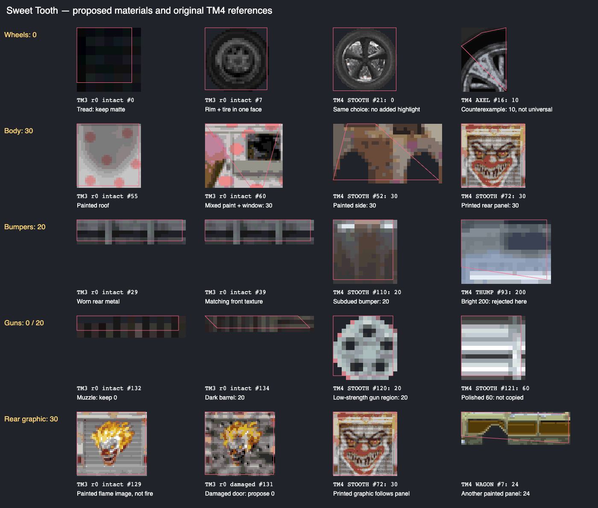
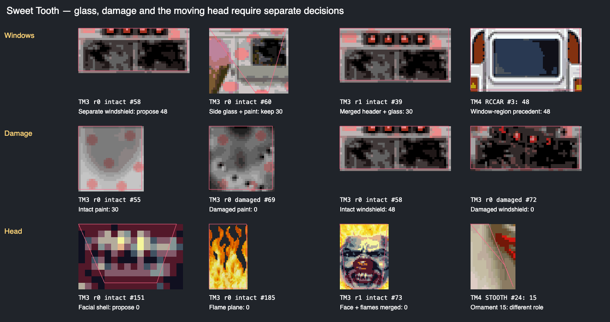
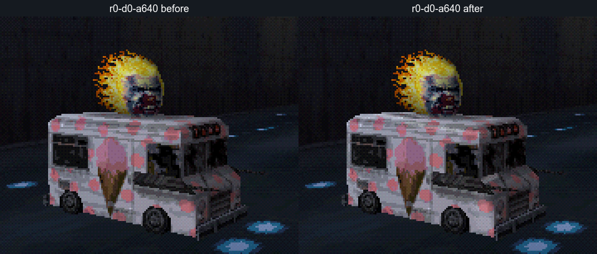
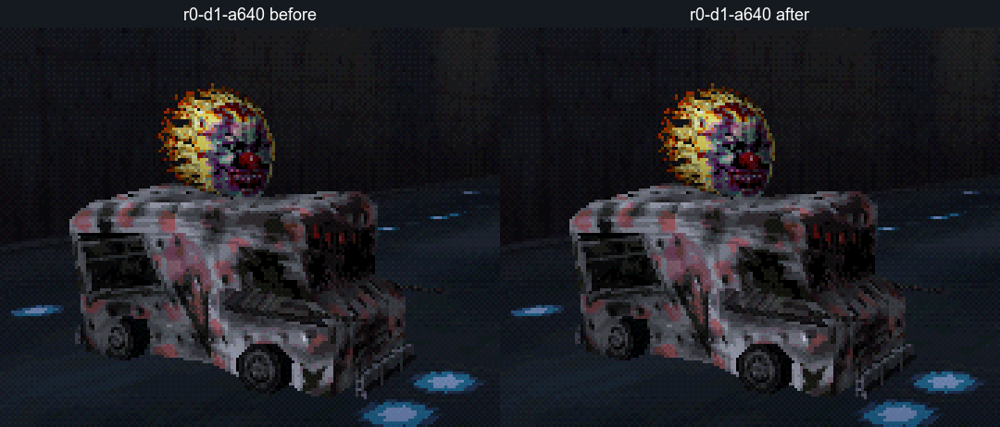

# Sweet Tooth surface reflections

**Implemented and checked in the engine.** The [builder profile](../apps/build-cars/src/reflections/index.ts) gives the truck a restrained painted-metal finish:
body `30`, subdued metal `20`, separate windshield `48`, wheels and head `0`.
These are new art choices informed by [original TM4 resources](tm4-car-reflections.md),
not recovered TM3 reflection values. Visual checks cover the selection menu,
Construction Yard and fixed Neon City views, including both damage frames and
all three LODs.

## Evidence and indexing

Inspected TM3 USA v1.1 `SWEET.CAR`: all three detail levels, both damage frames,
texture footprints and group geometry. The source identity is pinned in the
[car catalog](../apps/build-cars/src/catalog.ts). Source model data comes from the
[CAR parser](../packages/tm3-resources/src/car/index.ts).

Below, `r0/r1/r2` name the source detail levels; `G` and `#` are zero-based source
group and face indices within that level. **They are not converted MR indices.**
The source contains 388, 114 and 5 face records respectively. Groups and damage
frames can share records; these totals are not visible polygon counts.
TM4 references name intact `r0` faces in the original archive unless stated otherwise.

The figures show decoded texture crops with pink face outlines, not a preview of
the proposed reflections. Material labels are interpretations of texture and
geometry. The numeric TM4 reference values are read from original resources.

## Material decisions

| TM3 surface                                  | Proposed intact value | TM4 precedent and reason                                                                                                                                                                                                                                                                   |
| -------------------------------------------- | --------------------- | ------------------------------------------------------------------------------------------------------------------------------------------------------------------------------------------------------------------------------------------------------------------------------------------ |
| White/pink cab, box, roof and painted trim   | `30`                  | `STOOTH.MR` side `#52` and printed rear panel `#72` both use `30`. This direct counterpart is a better baseline than Microblast's brighter paint or Thumper's lower `16`.                                                                                                                  |
| Rear door with flaming-clown graphic         | `30`                  | It is a graphic on a panel, not a flame effect. TM4 Sweet Tooth's printed panel `#72` also follows the body value.                                                                                                                                                                         |
| Front/rear bumpers and grille/headlight face | `20`                  | Their grey, weathered texture suits `STOOTH.MR` rear bumper `#110 = 20`. Thumper bumper `#93 = 200` would introduce a polished accent absent from this truck's texture treatment. The grille/headlight face is mixed; `20` is a compromise for that whole face, not separate lamp shading. |
| Gun barrel surfaces                          | `20`                  | `STOOTH.MR` gun `#120 = 20` provides a subdued precedent. Its striped metal `#121 = 60` is a different finish and should not be copied to TM3's dark barrels.                                                                                                                              |
| Gun muzzle end planes                        | `0`                   | Keep the dark opening/end texture subdued. This is a local visual decision, not a claim that TM4 muzzle faces are always matte.                                                                                                                                                            |
| Separate front windshield                    | `48`                  | `RCCAR.MR` window `#3 = 48` gives a moderate precedent below Joneses' `64` and Thumper's `80`. The TM3 glass already contains strong mottled light/dark detail; start conservatively.                                                                                                      |
| Side faces containing both glass and paint   | `30`                  | Preserve the body baseline. A face has one reflection byte: assigning glass strength also brightens its painted area. No geometry subdivision is proposed in this pass.                                                                                                                    |
| Tread and wheel side caps                    | `0`                   | `STOOTH.MR #21 = 0` and `WAGON.MR #84 = 0` show that a silver-looking wheel texture need not receive a highlight. TM3 caps combine rubber and rim on one face; Axel's separate `4/10` treatment is not a direct match.                                                                     |
| Wheel wells, underside and dark nose lips    | `0`                   | Preserve the dark recesses; there is no useful reason to add a moving specular accent there.                                                                                                                                                                                               |
| Both head variants, including flame planes   | `0`                   | Keep the attack's presentation consistent. See the head-rendering constraint below; TM4's ornament value `15` is not adopted automatically.                                                                                                                                                |

### The head is also a projectile

The tempting reference is TM4 Sweet Tooth's clown ornament `#24 = 15`. TM3's head
has a different role: it leaves the truck during the special attack.

The [car module's `head_display`](../src/cars/sweet-tooth/module.c) calls
[`Tm3DisplayCarGroups`](../src/shared/model.c) for association `4`. That path reads
the intact near mesh, emits textured polygons with neutral color modulation, and
does not use the face reflection byte. Merely assigning `15` in the converted
resource would not add the same reflection layer to the flying head.

Keep the facial shell, yellow fire-backed surfaces and separate flames at `0`,
including the alternate head group and damaged frames. This prevents a newly added
highlight from disappearing at launch. It does not claim that all lighting is
identical between attached and detached rendering. If a shiny head is wanted later,
its projectile rendering needs a separate decision and visual check.

### Damage and distance

Use `0` for damaged body, glass and bumpers: the replacement textures show burns,
cracks and dirt. TM4 Sweet Tooth provides a strong precedent—its damaged `r0` has
128 faces at `0`, with only three retaining `20/60`. This is a deliberate frame
choice, not a universal damage multiplier.

TM3 gun faces are shared by the intact and damaged frames. Retain `20` on their
barrels and `0` on their muzzle ends; they have no separate damaged texture here.

Author `r1` independently. In particular, `r0 #58` is a separate windshield,
whereas `r1 #39` includes the upper painted header. Give that combined face `30`.
Keep all of `r2` at `0`, following all 22 original TM4 cars. The `48 → 30 → 0`
windshield assignment was checked in fixed engine views at all three LODs. This
checks material consistency, not the visual smoothness of a moving LOD transition.

## Implemented assignment

Ranges are inclusive. Every face not listed as nonzero stays `0`, including all
head faces. Assignments must be resolved against source faces before conversion;
matching converted indices or adding a fixed offset for damage is unsafe.
For example, the near nose uses six intact faces but seven damaged faces.

| Level / frame | Value | Source face indices                             |
| ------------- | ----- | ----------------------------------------------- |
| `r0`, intact  | `20`  | `29–33`, `39–43`, `115`, `134–137`, `140–143`   |
| `r0`, intact  | `30`  | `53–57`, `59–67`, `85–97`, `112–114`, `128–129` |
| `r0`, intact  | `48`  | `58`                                            |
| `r0`, damaged | `20`  | `134–137`, `140–143` (shared gun barrels)       |
| `r1`, intact  | `20`  | `5`, `7`, `8`, `56`, `64`                       |
| `r1`, intact  | `30`  | `10`, `14–20`, `34–41`, `57–59`                 |
| `r1`, damaged | `20`  | `5`, `7` (shared gun barrels)                   |
| `r2`, both    | `0`   | All faces                                       |

Source group landmarks for reviewing the assignment:

| Part                      | Near groups (`r0`)                 | Medium groups (`r1`) |
| ------------------------- | ---------------------------------- | -------------------- |
| Wheels                    | `G0–3`, sharing face records `0–8` | `G0–3`, faces `0–3`  |
| Wheel wells               | `G4–5`                             | `G10`, `G12`         |
| Rear/front bumper         | `G6–7`                             | `G6`, `G14`          |
| Cab / rear box            | `G10`, `G12`                       | `G11`, `G9`          |
| Front nose / rear graphic | `G13`, `G15`                       | `G13`, `G7`          |
| Guns                      | `G16–17`                           | `G4–5`               |
| Head variants             | `G18–19`                           | `G17–18`             |
| Remaining underside       | `G8–9`, `G11`, `G14`               | `G8`, `G15–16`       |

## Engine verification

Compared three near camera angles and intact/damaged r0/r1 against the matte
resource using engine RGB readback in Neon City. Paint stays restrained; wheels,
head and flames do not acquire a metallic layer. Medium geometry retains its
paint baseline, damaged replacement bodywork is matte, and r2 remains matte.
The built MR matches the source-face profile in every group/frame/LOD; only face
reflection bytes differ from baseline conversion.

The existing Sweet Tooth check passed head launch, remote detonation, timeout,
contact damage, audio cleanup, turbo cleanup, local rollback and portable restore.
A separate material-lifetime check verified original reflection-byte hashes after
cloak/shield input sequences and a directly injected freeze timer, including
rollback and portable restoration. That check covers material restoration, not
the freeze projectile's targeting.

This decision applies only to Sweet Tooth. In particular, neither the matte wheels
nor the `30/20/48` palette is a default for the remaining TM3 cars.
