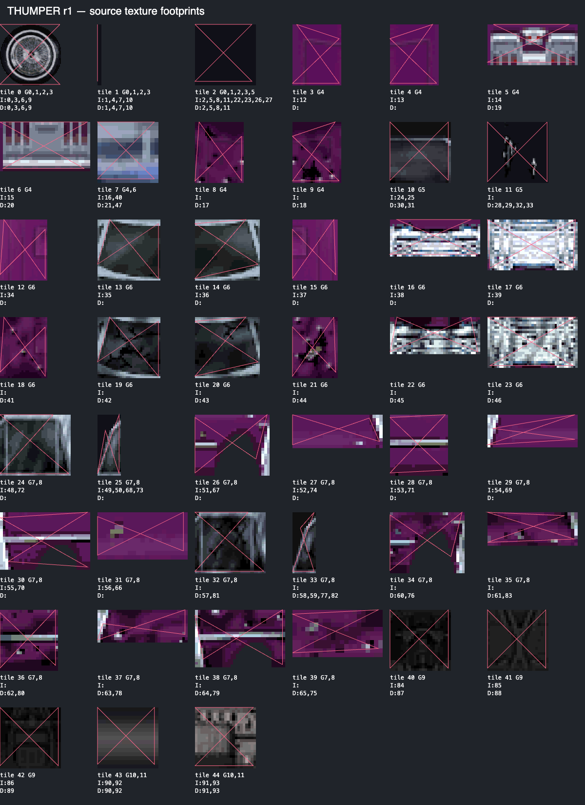
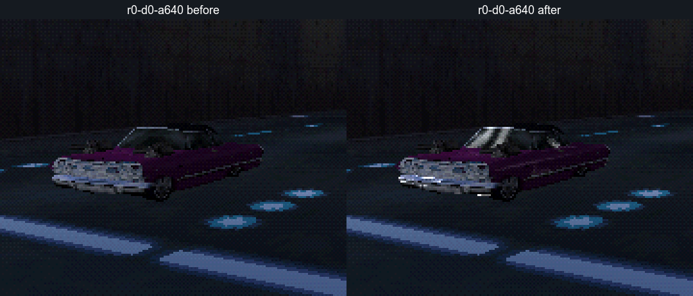
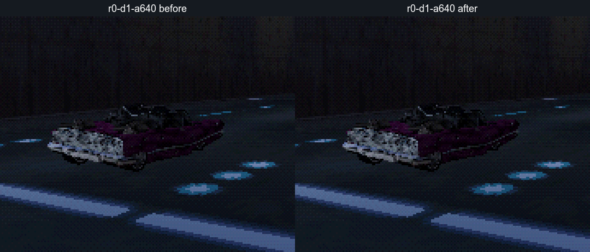

# Thumper surface reflections

Thumper keeps pink paint, a matte black roof and strong but narrow bumper accents.
The original TM4 Super Thumper is the closest reference, not a global car preset.

## Evidence and decisions

Inspected USA v1.1 THUMPER.CAR: 226/94/5 source face records, texture footprints,
vertices and both frames. Bumpers have separate bright faces; side silver strips
are baked into much larger pink panels. The black roof shares a dark texture
region with non-reflective details and is treated as matte, not polished paint.

| Surface | Strength | TM4 reference and reasoning |
| --- | --- | --- |
| Pink body, bonnet, boot, mixed paint/trim faces | 16 | Super Thumper paint. The narrow silver stripe does not justify reflecting the whole door as chrome. |
| Front, rear and side windows | 80 | Super Thumper near glass. Keep the same value in the medium mesh because its panes remain separate. |
| Separate bright bumper faces and wraps | 200 | Super Thumper bumper accents. Still ordinary specular strength, not special value 255. |
| Grille panels | 10 | Super Thumper front details; keep the already bright grille texture readable. |
| Separate rear bright trim | 50 | Super Thumper bright trim and fittings. Mixed pink/trim faces remain 16. |
| Damaged body, glass, bumper and trim | 4 | Super Thumper's damaged finish; damage should lose the intact chrome emphasis. |
| Black roof, wheels, underbody, plate, textured guns | 0 | Matte roof is an artistic decision for this source material. Original Super Thumper also leaves its textured gun surfaces at 0; do not turn the TM3 crossed barrel planes into shiny slabs. |
| r2 | 0 | Original TM4 distant meshes are matte. |

## Mapping boundaries

Near windows: #16–19, #76/#77, #122/#123, #190/#191. Roof #192–201 stays 0,
including the black pillars. Near bumper faces: #74/#75/#78/#79, #96–99,
#118–121/#124/#125, #167–170. Front grille #100/#103 stays 10; the upper front
#101/#102 includes pink paint and remains 16. Rear #171/#172 is separate bright
trim (50), while #166/#173 includes paint (16) and number plate #174 is 0.

G7 has reversed source frame ordering: intact #74–95, damaged #48–73. It is
mapped by the actual frame descriptors, not a fixed index offset. Damage-only
black end faces #73/#164 stay 0; plate #183 also stays 0.

Medium #16/#40 preserves the distinct bumper at 200. #39 is grille (10), #15
rear bright trim (50). Front #38 and rear #14 mix paint and fittings, so remain 16.
Windows #24/#25/#35/#36/#48–50/#68/#72/#73 use 80, with damaged panes at 4.
The black roof and shared gun groups remain matte in both frames and all LODs.

## Verification

Built-MR validation confirms only 222 reflection bytes changed, with exact
assignments in all LODs and frames, including reversed G7 frame ranges. Engine RGB
comparisons in Neon City cover three near angles and both frames of all LODs.
Bumpers catch small bright highlights while the roof remains black and paint pink;
the damaged material loses the bright accent. Lint/types/format pass.

The Thumper special check passes stream timing, target damage and identical local
and portable replay. The material check separately restores exact authored
reflection-byte hashes after cloak/shield sequences and an injected freeze timer,
including local rollback and a portable snapshot in a fresh match. Timer injection
checks material lifetime, not aiming a freeze missile.

