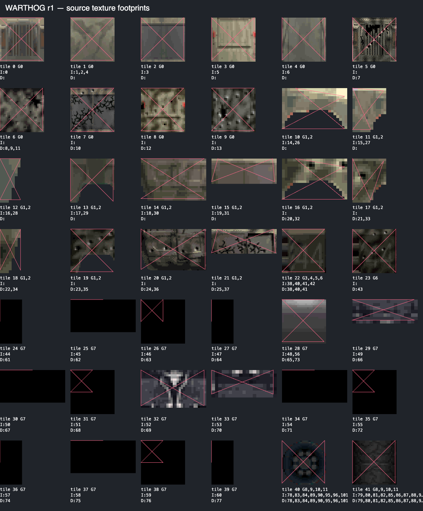
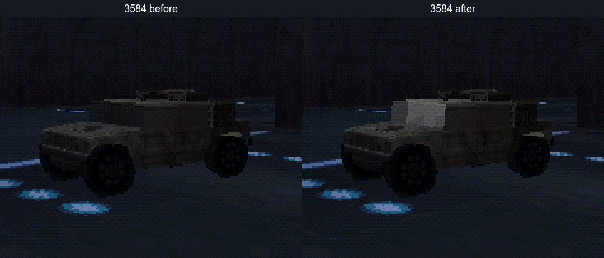
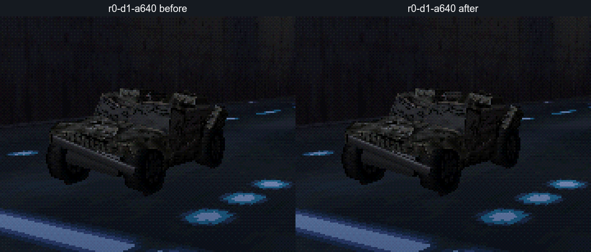

# Warthog surface reflections

Warthog gets restrained camouflage, slightly brighter glazing and working metal.
No polished chrome accents are added to the military body.

## Evidence and decisions

Inspected USA v1.1 WARTHOG.CAR: 252/102/5 source face records, both frames,
texture footprints and vertices. Gen. Warthog's original TM4 resources use body
and gun boxes at 20, gun surfaces at 30, damaged body at 4 and treads at 0.
Those are the primary references; the TM3 model additionally has a closed glazed cab.

| Surface | Strength | TM4 reference and reasoning |
| --- | --- | --- |
| Camouflaged body, roof, rear structure and side/top box casings | 20 | Gen. Warthog body and gun boxes. Preserve the camouflage instead of making military paint chrome. |
| Cab panes | 40 | Meter Maid glass: enough separation from camouflage, below the sportier Thumper 80. |
| Central roof gun walls | 30 | Gen. Warthog gun surfaces, including the damaged frame. The muzzle remains 0. |
| Dark bumper and exposed crossmember faces | 10 | Trash Man dark working-metal guard. Keep the texture's edge accent without a bright chrome band. |
| Damaged body, panes and bumper | 4 | Gen. Warthog damaged body; the whole battered shell becomes subdued. |
| Box vents, grille, muzzle, wheels and underbody | 0 | Leave openings dark and rubber matte. Reflection is per face, not a way to brighten holes. |
| r2 | 0 | Original TM4 distant meshes are matte. |

## Mapping boundaries

Near cab panes #14/#15/#36/#37 and #131–133 are separated from the camouflage.
Box casings #55/#56/#58, #65/#66/#68, #75/#76/#78, #85/#86/#88 use 20;
their slatted end faces remain 0. G9 repeats intact #84–88 in both frames, so those
shared casings retain 20. Unreferenced #89–93 are not assigned. Other boxes have
separate damaged geometry at 4, still excluding slatted ends.

Central roof gun #94/#95 and damaged #97/#98 use 30; both muzzle faces stay 0.
The bonnet vent #128 remains matte. Front grille #104 is separate from mixed
headlamp/body #103/#108 (20). Dark bumpers #101/#102/#106/#107/#208/#211
and exposed lower crossmembers #222/#239 use 10. Remaining wheel-well and floor
geometry stays 0; small black bumper caps also remain matte.

Medium #3/#19/#31 are glazing. The source merges the complete front into #0,
including grille, lamps and painted border; it uses body strength 20 instead of
inventing pixel-level materials. Box faces #38/#40/#41 are shared between frames
and retain 20; #42 has a damaged counterpart #43 at 4. Source #39 is unreferenced.
Medium crossmembers #48/#56 use 10, with damaged #65/#73 at 4. Wheels/floor stay 0.

## Verification

Built-MR validation confirms only 233 reflection bytes changed, with exact
assignments across all LODs, frames and group splits. Engine RGB stills in Neon City
cover near views around the car and intact/damaged versions of all LODs. The paint
stays restrained; glazing produces a localized highlight at oblique angles. A low
strength on flat camouflage is intentionally less conspicuous than Spectre or
Thumper. Lint/types/format pass.

The Warthog special test passes the three-missile volley, flight, expiry, direct
and world impacts, world-object destruction, local rollback and portable replay.
The material check restores the original reflection-byte hashes after cloak/shield
sequences and an injected freeze timer, through local rollback and portable
restoration into a fresh match. Timer injection checks material lifetime, not aiming.

