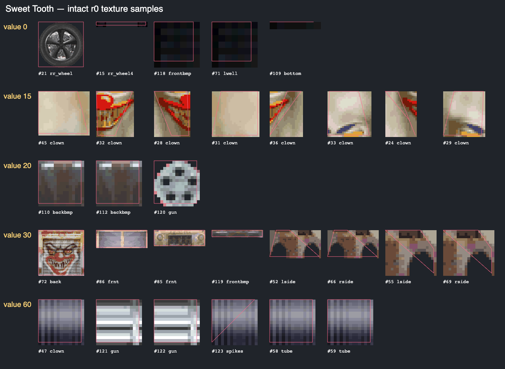
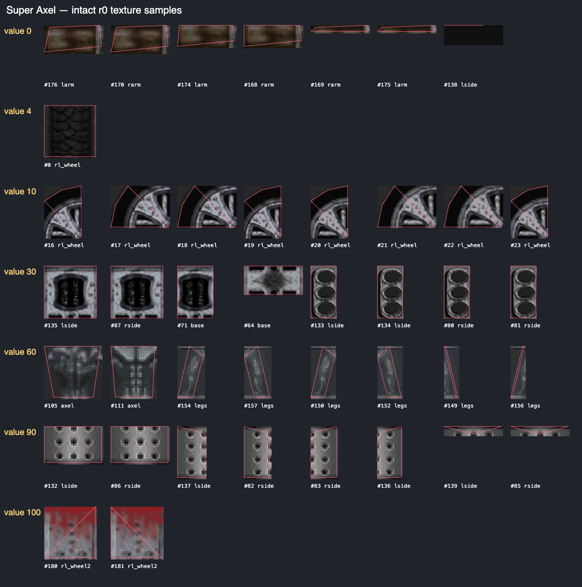
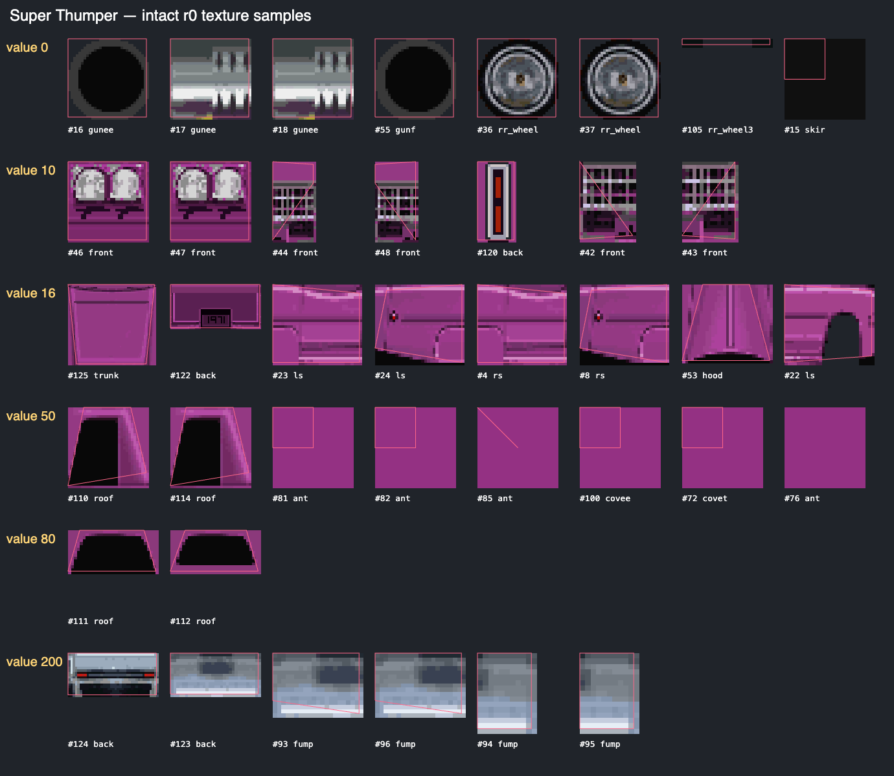
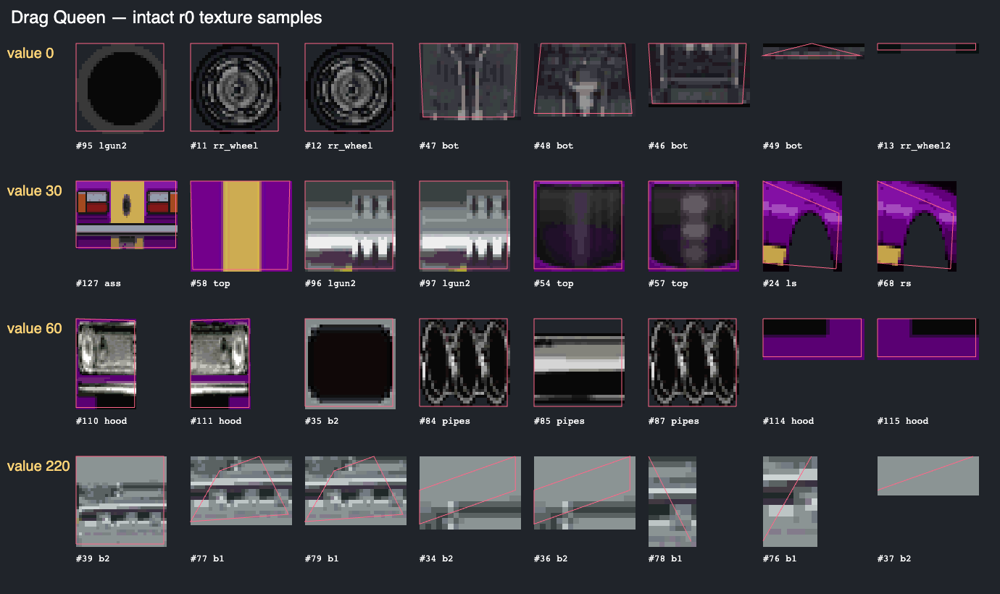
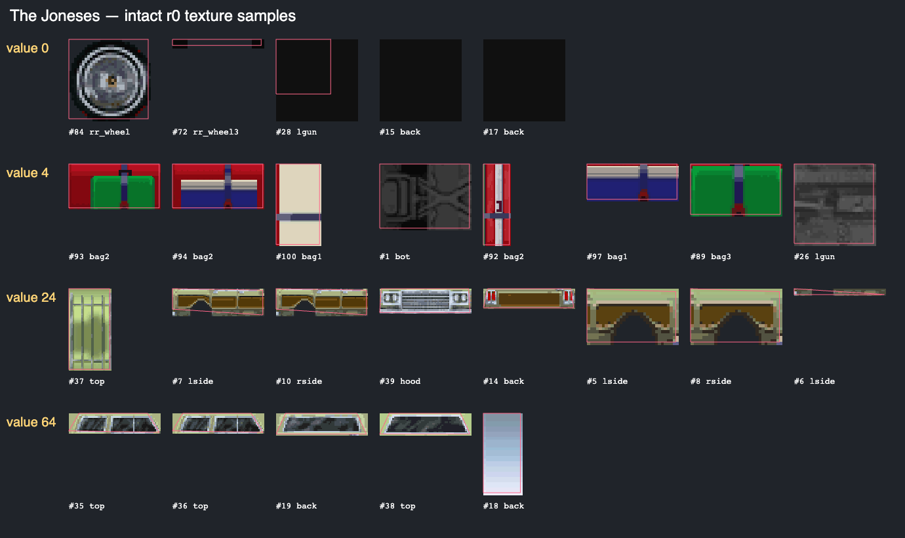

# TM4 car reflections: original resources and transfer rules

The original cars use authored, per-face highlight strengths. Material classes are
useful for adapting TM3 cars, but there is no universal material-to-number mapping.
This study changes neither TM3 resources nor their converter.

## Scope and interpretation

Inspected the 22 characters registered in the original TM4 USA `MAIN.MR`, their
car archives, all three LODs and both damage frames on 2026-11-19. The archives
contain 5,699 `FaceList` records in total; this is not a count of simultaneously
visible polygons. Frame ranges can share records.

Values below come from original disc resources, before relocation or temporary
shield, freeze and invisibility effects. Material names such as glass or painted
metal are visual interpretations of textures, geometry and group names. They are
not material IDs stored in MR.

The illustrations sample the original texture page and CLUT at each face's UVs.
They show texture crops, **not rendered reflections**. Pink lines mark face outlines;
`#N` is the zero-based index in the archive's `display/resolution/FaceList`, followed
by the group name. Samples use intact `r0`. A crop can contain pixels outside the
outlined face. The selection is illustrative, not an exhaustive face inventory.

## What the parameter does

[`CarRenderFace`](../external/rusty-metal-4/game/include/tm4/modules/car.h)
stores `reflection` at byte 2 of each 24-byte face record.

| Value   | Driving renderer behavior                                                                                                             |
| ------- | ------------------------------------------------------------------------------------------------------------------------------------- |
| `0`     | No additional reflection layer. Normal lighting still applies.                                                                        |
| `1–254` | Adds a semitransparent highlight layer using the world's `textures/reflspec`; the value supplies its RGB modulation.                  |
| `255`   | Selects `textures/reflchro` and an opaque polygon command instead. This is a different rendering mode, not the next strength setting. |

See [wheel/body rendering](../external/rusty-metal-4/game/src/modules/car/wheel_render.c)
and [world texture setup](../external/rusty-metal-4/game/src/main/world.c).
Reflection UVs depend on transformed normals and projected positions and are
clamped to the 64×64 reflection texture. This is texture-based shading, not a
reflection of nearby scene geometry. The byte is neither a percentage nor a
roughness parameter.

Original car records use values from `0` to `220`, with no `255`.
The [effect code](../external/rusty-metal-4/game/src/modules/car/model_effects.c)
assigns `255` for shield and `254` for freeze; these runtime overrides must not be
mistaken for authored surface settings.

The [menu renderer](../external/rusty-metal-4/game/src/modules/menu/model_reflection.c)
uses its own reflection texture and its texture-page blend mode. In the inspected
original menu that page is 0x9a (ABR 0): semitransparent texels blend half the
background with half the reflection. A dark reflection texel can darken the car.
Gameplay world setup explicitly selects ABR 1, additive blending, for reflection
textures. The same authored strength therefore need not look equally bright in
the menu and on a map. Check the driving renderer before increasing strengths
to compensate for menu darkening.

## Examples from original cars

### Sweet Tooth: a hierarchy within one car

`STOOTH.MR`: wheel face `#21` has `0`; the clown ornament includes `15`;
body panels such as `#52` and `#72` use `30`; tube and spike faces such as `#58`
and `#123` use `60`. The gun alone contains both `20` and `60`.
A part name does not imply one material or one value.

### Super Axel: do not classify an entire wheel as one material

`AXEL.MR`: tread face `#0` uses `4`, rim/sidewall faces such as `#16` use `10`,
frame faces such as `#135` use `30`, and brighter frame details such as `#132`
use `90`. Arm faces such as `#176` have `0`. Auxiliary `rl_wheel2` faces use `100`.

### Super Thumper and Drag Queen: strong accents are still specular

`THUMP.MR`: painted body faces such as `#23` use `16`, roof/window-region faces
`#111–112` use `80`, and bumper faces such as `#93` use `200`.
Not all pink surfaces share a value: other details use `50`.

`DRAG.MR`: much of the painted body uses `30`, pipes and other details use `60`,
and bumper groups `b1`/`b2` include `220` (for example `#77` and `#39`). Even these
bright metal accents do not use the special `255` chrome mode.

### The Joneses: distinguish glass from paint and luggage

`WAGON.MR`: luggage groups use `4`, body panels such as `#7` and `#37` use `24`,
and window faces such as `#35` use `64`. Wheel face `#84` has `0` despite a
silver-looking disk in its texture. Some apparent shine is already painted in.

## Cross-car findings

- **Color is insufficient.** Dark faces can be windows, rubber or cavities;
  silver-looking textures can have no extra highlight. Trash Man's spike faces
  include `0`, unlike Sweet Tooth's spikes at `60`.
- **A texture footprint is a useful grouping key, not a material ID.** Within
  each car's intact `r0`, compare texture page, CLUT and the unordered set of UV
  corners. In 21 of 22 cars, matching keys never had different reflection values.
  RC Car is the exception: `RCCAR.MR` gun faces `#30–32`, `#35–38`, `#41` use `48`,
  while switch faces `#92–96` use `0` with the same key. Geometry/part context must
  be able to override texture-based grouping. This comparison does not establish
  equivalence for overlapping UV regions or for other LODs and damage frames.
- **Each car has its own baseline.** Examples of intact painted panels include
  Thumper `16`, Trash Man `20`, Joneses `24`, Sweet Tooth and Drag Queen `30`,
  Orbital `48`, and Microblast `60`. A single global “paint” value loses this range.
- **Material categories have exceptions.** Axel tread uses `4`; Goggle Eyes wheel
  faces include `8`; many other cars use `0` for their complete wheel texture.
  Physical plausibility alone does not reproduce the original art direction.

## Damage and distance

Damage generally reduces highlights, but there is no common multiplier:

| Original resource  | Observation                                                                                                                                                     |
| ------------------ | --------------------------------------------------------------------------------------------------------------------------------------------------------------- |
| `STOOTH.MR`, `r0`  | Intact values include `15`, `20`, `30`, `60`; damaged frame has 128 faces at `0`, one at `20`, two at `60`.                                                     |
| `ORBITAL.MR`, `r0` | Intact frame has 40 faces at `48`; damaged frame has 43 at `8`. These are frame inventories, not a one-to-one face pairing.                                     |
| `RCCAR.MR`         | Both frames have the same reflection-value histogram at each LOD. This does not imply identical per-face assignments: `r1` has differences within group ranges. |
| `MINION.MR`, `r0`  | Intact frame is entirely `0`; damaged frame has 92 faces at `2` and 28 at `0`. Preserve this exception rather than forcing a decreasing rule.                   |

All 22 cars have **only `0` in `r2`**, in both frames. `r1` has independently
authored values and geometry; it is not simply a copy of `r0` with fewer faces.
For example, intact Minion uses `8` throughout `r1` despite using `0` in `r0`.

## Rules for a future TM3 pass

These are proposed authoring defaults inferred from the examples, not hidden TM4
engine rules or recovered TM3 settings.

| Surface category                              | Initial range to evaluate                                                        |
| --------------------------------------------- | -------------------------------------------------------------------------------- |
| Rubber, cavities, underside, subdued surfaces | `0–8`, normally starting at `0`                                                  |
| Painted body                                  | `16–60`, chosen relative to the car's overall finish                             |
| Glass and exposed bright metal                | Often `60–100`; use lower values where the texture already carries the highlight |
| Deliberately bright metal accents             | `200–220`, sparingly                                                             |
| Special chrome mode                           | Do not assign `255` as a normal material default                                 |

1. Classify **faces**, using texture regions, geometry and neighboring faces.
   A whole group can contain several materials; one face can also span a mixed
   texture region and cannot give its individual texels separate strengths.
2. Reuse assignments for matching texture footprints and symmetric details,
   with explicit exceptions for different physical uses of the same texture.
3. Choose a small palette of strengths per car. Keep uncertain surfaces subdued
   until inspected; avoid making every metallic-looking texel highly reflective.
4. Author damage settings separately. Do not assume a uniform reduction factor
   or a face-index correspondence between different meshes.
5. Keep `r2` at `0`; check `r1` independently and avoid distracting changes at LOD
   transitions.
6. Verify normals and reflection lookup positions before tuning intensity. Then
   compare actual driving views under several maps' reflection textures.

The evidence supports a texture-region classification with per-face exceptions
and per-car tuning. It does not support fully automatic material recognition from
pixel color, or a universal strength for every instance of “metal”, “glass” or “paint”.
